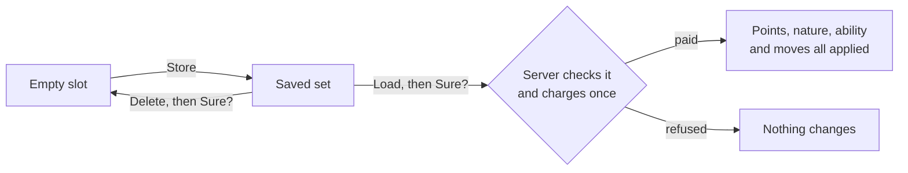

# Saved Sets

A **set** is a whole build: a Pokémon's stat points, nature, ability and four moves. Each Pokémon
keeps four of them, on the **Sets** tab of its summary's **Stats** page, next to **SP**.

## The four slots

Each row is a slot, numbered 1 to 4. A slot shows the name you gave it, or, until you name it, its two
biggest stats (`Atk 32 · Spe 32`). An empty slot says `— empty —`.

Click a row to select it. The buttons under the list act on the selected slot:

| Selected slot | Buttons |
|---|---|
| Empty | **Store** |
| Saved | **Load** and **Delete** |

A saved set is never written over. To save a different build in its place, delete it first.

## Store

Saves the Pokémon **as it is**: the stat points it has bought, its current nature and ability, and
its moves. Changes still waiting on the SP tab's **Save** are not part of it.

## Load

Puts the whole set on the Pokémon **at once**: stat points, nature, ability and moves.

1. Select the set. Its price appears under the buttons.
2. Press **Load**. It turns into **Sure?**.
3. Press it again. The server checks the set, charges the price once and applies everything, and a
   chime confirms it. Any unsaved changes on the SP tab are dropped.

**Load** stays grey when:

- the set is already exactly what the Pokémon has;
- you cannot afford it;
- it uses a move this Pokémon cannot learn, or an ability it cannot have, for example after it
  evolved into a different form;
- it asks for more points than a stat or the budget can hold.

For the last three, the reason is written under the buttons.

A set is never loaded in part. The one exception is a part the **server** does not let you train:
on a server where natures only come from mints, a set still loads its points, ability and moves,
and leaves the nature alone.

## Delete

Press **Delete**. It turns into **Sure?**; press it again to empty the slot, name and all. Clicking
anything else in between cancels it.

## Naming a set

Click the **name** of the slot that is already selected, type, and press **Enter**. **Escape** cancels
and **Backspace** deletes. A name holds up to 18 characters. Every key goes to the name while you type,
so the letter that normally closes the summary does not.

## Reading a set without loading it

Rest the cursor on a saved slot. The tooltip lists:

- its six stat points and their total;
- its nature, with the stat it raises in green and the one it lowers in red;
- its ability;
- its moves, each in its type's colour.

Hovering an empty slot shows nothing.

## Where sets are kept

On **your computer**, in `config/cobblemon_champions_training_profiles.json`, filed under each
Pokémon. They are not stored on the server, so another computer does not have them. The file keeps
sets for up to 64 Pokémon; past that, the Pokémon whose sets changed longest ago is dropped.

[Training Costs](training-costs.md) has what a set costs to load.
