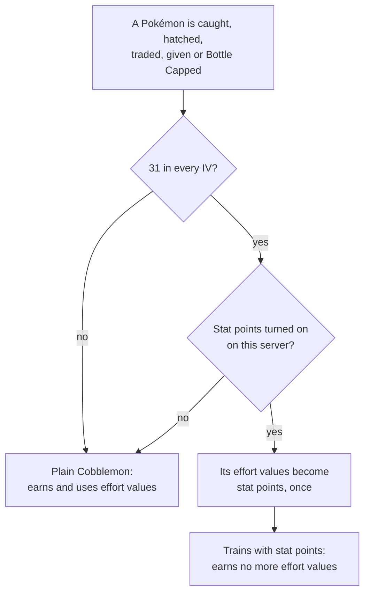

# Stat Points

A Pokémon in training has **stat points** where it used to have effort values. They follow the
Pokémon Champions standard: a small budget you spend on purpose, instead of a number that piles up
from whatever the Pokémon knocked out.

## The numbers

| | Effort values | Stat points |
|---|---|---|
| Most in one stat | 252 | **32** |
| Most in total | 510 | **66** |
| Worth, per unit | depends on the level | **+1 to the stat, at any level** |
| Earned by | defeating Pokémon | buying them, on the SP tab |

A point is added to the stat **before the nature** is applied, so a nature that raises a stat raises
the points in it too. HP takes its points as they are.

Because a point is always +1, the same 32 points add the same amount to a Pokémon at level 5 as at
level 100.

## Converting from effort values

A Pokémon switches over **once**, the first time it is 31 in every IV. Its effort values are read as
points it had already spent, at the same rate Pokémon HOME uses: the first point in a stat is worth
4 effort values, and every point after that is worth 8.

| Effort values in a stat | Stat points |
|---|---|
| 0–3 | 0 |
| 4 | 1 |
| 12 | 2 |
| 252 | 32 |

A classic 252 / 252 / 6 spread becomes 32 / 32 / 1: 65 points, one under the budget. When a Pokémon
brings more than 66 points' worth, the biggest stats are kept first and the smallest are trimmed.

It switches over whenever the game next looks at it:

- when it hatches or joins your party (caught, traded, given);
- when Bottle Caps raise its last IV to 31;
- the first time it would earn effort values in battle;
- the first time you train it: **Save**, **Train** or **Load**.

Once it has switched:

- it **never earns effort values again**;
- its moves are always at their full PP, including the moves it learns by levelling up.

!!! note "Bottle Caps"

    By default, IVs raised with Bottle Caps count toward the 31s. A server can make only natural IVs
    count; a Pokémon that already switched over with Bottle Caps stays in.

## The SP tab

Open the Pokémon's summary, go to **Stats**, and pick **SP**, where the EV tab used to be. The
buttons only work in a summary opened by a [Champions Trainer](champions-trainer.md); anywhere else
the tab shows the points with the buttons greyed out.

| Control | What it does |
|---|---|
| `SP  x / 66` | Points in use, out of the budget |
| **−** / **+** | Take a point off a stat, or put one on |
| **++** | Fill the stat as far as it can go, within 32 and what is left of the 66 |
| the bar under each stat | How full that stat is, out of 32 |
| **Reset** | Take every point off |
| **Save** | Buy the whole change at once |

Nothing is spent while you click **−**, **+**, **++** and **Reset**: you are editing a draft. The
price of the whole draft appears under **Save**. Taking a point off costs the same as putting one
on, because what you pay for is the change; moving a point from Attack to Speed is two changes.

- If you cannot afford the draft, the price turns red, the reason is written under it, and Save
  stays grey.
- After you press Save, the button greys out until you change something, and a chime confirms the
  purchase.

The summary's stats reflect the new points straight away, and they are there the next time you open
it. [Training Costs](training-costs.md) has the prices.

## When a server changes the rules

| Setting | Effect on stat points |
|---|---|
| **Stat points** off | Every Pokémon uses and earns effort values as in plain Cobblemon, and the summary shows its own IV and EV tabs. Points already spent are kept, and come back as they were when this is turned on again. |
| **Require perfect IVs** off | Every Pokémon can train, whatever its IVs. |
| **Bottle Caps unlock training** off | Only natural IVs count toward the 31s. |

A Pokémon already over its budget can always save a spread that uses fewer points, never one that
uses more. See [Commands & Config](commands.md) for how to change these.
