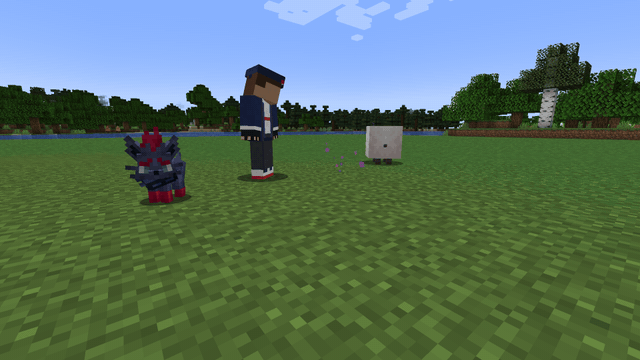
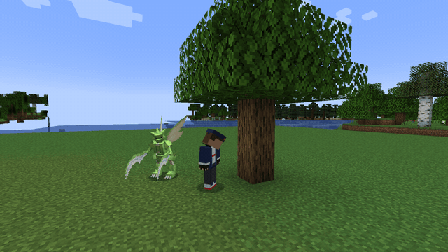
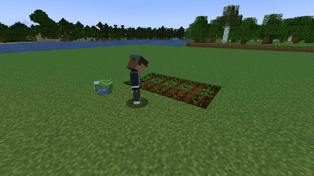
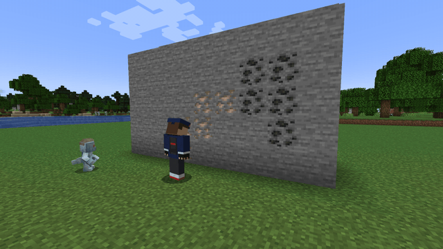
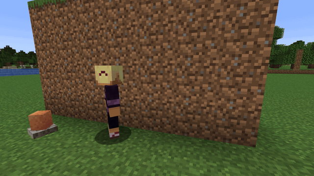
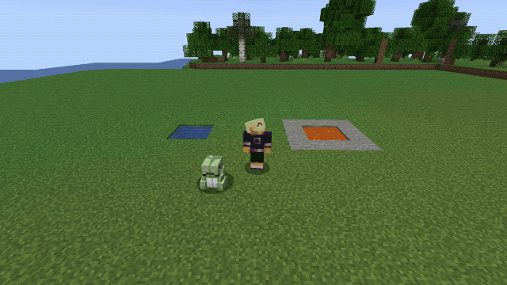
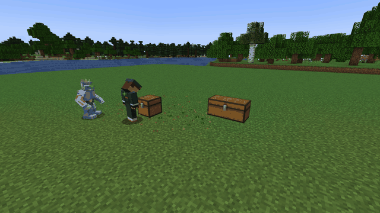
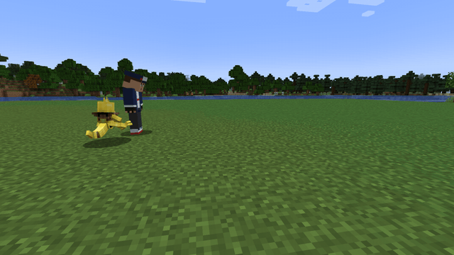

# Partner HMs

Partner HMs are the ones your **empty fist** fires. One of your sent-out Pokémon **lends** you one:
open Cobblemon's interaction wheel on it, pick **Field moves**, then **"Lend me …"**. While that
Pokémon is out and within 24 blocks, a click with an empty hand fires the HM. One Pokémon lends one
HM at a time: picking another replaces it.

Each use costs the Pokémon a little **fullness** (see [Keeping it fed](../pokemon.md#keeping-it-fed)).
Some HMs also have a **cooldown, kept per Pokémon**: two Pokémon that both know Teleport each have
their own.

1. Do Click with an empty hand
2. Check A Pokémon of yours, out and near you, is lending the HM
3. Check That Pokémon still has friendship (at 0 it refuses)
4. Check Your experience level is high enough (if the server sets one)
5. Check That Pokémon's cooldown has run out
6. Result The HM fires, the Pokémon pays its fullness and its cooldown starts

If any check fails, nothing happens.

---

## Who can lend it

A Pokémon can lend an HM when it **has learned the move**, one of its four or one it swapped out.
A move merged into an HM counts for it too, so a Pokémon that knows X-Scissor can lend Cut. On a
server that lets species count, these can always lend it:

| Disc | HM | Pokémon (any of) |
|---|---|---|
|  | Camouflage | Zorua, Kecleon, Ditto |
|  | Charge | Elekid, Electabuzz, Electivire |
|  | Cut | Scyther, Scizor, Kartana, Kleavor, Vikavolt |
|  | Decorate | Sylveon, Milcery, Togekiss |
|  | Dig | Diglett, Dugtrio, Trapinch |
|  | Leafage | Bulbasaur, Chikorita, Treecko, Snivy, Drilbur, Excadrill |
|  | Rock Smash | Hitmonchan, Machop, Geodude |
|  | Stockpile | Gulpin, Swalot, Squirtle, Totodile, Mudkip, Camerupt, Magcargo, Heatran |
|  | Strength | Machoke, Machamp, Conkeldurr |
|  | Tail Whip | Rattata, Sentret, Buneary |
|  | Teleport | Abra, Kadabra, Alakazam, Ralts |
|  | Growth | Sunkern, Sunflora, Petilil |
|  | Minimize | Ditto, Chansey, Barboach |
|  | Outrage | Dragonite, Salamence, Haxorus |
|  | Calm Mind | Alakazam, Espeon, Gardevoir |
|  | Celebrate | Jigglypuff, Ludicolo, Alcremie |

---

## Ability details

###  Camouflage
**Cooldown:** 15 min · **Power:** 18000t (**15 minutes**)

Become the **living creature** you're looking at. Your model is replaced by theirs — species, form,
variant, gear and its nametag — for everyone who can see you. Copy a trainer from
**Radical Cobblemon Trainers** and you wear that trainer's own skin.

- Aim at a **creature** in clear view → you look exactly like it for 15 minutes.
- **Fire it again while you are wearing one** → the costume comes off and the HM is ready
  immediately, so changing disguise is two presses.
- A block, a wall between you and it, or empty air → nothing happens. You can only copy something
  you can actually see.
- Other **players** can't be copied.

The disguise is a costume, not a creature: nothing extra exists in the world, so there is nothing
to hit, nothing in your way, and nothing that can be killed off you.

---

###  Charge
**Cooldown:** 3s · **Power:** ticks between sparks (**10**)

Turns the block you aim at into a redstone power source — enough to throw a door, a piston or a
lamp from across a room. **The charge is permanent.** It is saved with the world, so it stays when
you log off and when the server restarts, and charging another block does not take it back: charge
as many as you like. Aim Charge at a charged block again to discharge it. Breaking the block ends
its charge too.

The block is never replaced — it stays exactly what it is and simply *answers* as a power source —
so you can charge a chest, a furnace, a statue or a wall without losing anything. While it is live
it glows with **redstone dust** on its faces, so a charged block is one you can find again.

---

###  Cut
**Cooldown:** none · **Power:** max 128 blocks

Aim at a **log** and the tree comes down — its logs, with the leaves and vines tangled in it. Only
**that one tree**: a neighbour whose canopy touches it is left standing, and you hear it fall once,
not a hundred break sounds. A log somebody placed, like a cabin wall, comes out on its own. Aim at a
**leaf** or a **vine** and just that tangle goes.

It also **cuts plants**: grass, ferns, crops, ground cover. Those come away as if you had used
shears, so the drops are the careful ones — the grass itself rather than a couple of seeds — and
that holds for plants added by a datapack too, because it is the game's own loot tables answering.

**With nothing to cut in front of you, it clears the ground around you** (this is what X-Scissor
used to do), in two passes of decreasing politeness:

1. **Weeds first** — grass, ferns, dead bushes. If there are any, that is all it touches.
2. **Then what somebody planted** — flowers and crops, and *only* once there is not a single weed
   left in range (radius 5). Casting by accident in your own wheat field costs you the weeds, not
   the field.

It never strips grass down to dirt: as a fallback, that would go off every time you missed a tree.

---

###  Leafage
**Cooldown:** 2s · **Power:** radius 3 (a **7×7** patch)

Instantly grows **every crop around you** to full maturity — handy for fast harvests — and does
the same for saplings and berry trees.

The bare ground answers too, and it answers in **flowers**: a burst leaves a meadow rather than a
lawn, with the odd blade of grass among it. The blooms are ones that belong to the biome you are
standing in, so a burst in a plains looks nothing like one in a flower forest — and a biome with no
flowers of its own gets grass rather than a dandelion that does not belong there.

It only ever plants on **bare ground**. A spot that already has something growing on it is left
exactly as it stands, so casting twice in the same meadow thickens it instead of disturbing it, and
tall flowers are planted whole rather than as a half that topples.

Only crops, saplings and berry trees are grown. Grass blades, ferns, moss, nylium, glow lichen and
seagrass are left alone, so a burst never smothers the meadow it planted or creeps moss over the
stone nearby.

**Crouch while you use it to till instead** (this is what Rototiller used to do): the dirt-type
block you aim at, within your normal reach — Dirt, Grass Block, Coarse Dirt, Dirt Path — turns into
Farmland. A flower or grass on it drops as an item. Tilling has **no cooldown** and does not use up
the burst's.

It changes the world, so it needs the right to build: it does nothing in adventure or spectator
mode, and skips spawn protection and claimed land. The radius (`power`) is capped at 16.

---

###  Rock Smash
**Cooldown:** none · **Power:** max 32 ores

Instantly breaks the block you aim at. If it's an **ore**, vein-mines all connected ore of that
type; otherwise breaks the single pickaxe-minable block (Netherite Pickaxe drops). Dirt, sand and
the rest of what a shovel takes are [Dig](#dig)'s.

---

###  Dig
**Cooldown:** none

What a shovel takes, **dirt, sand, gravel, clay and snow**, comes out in one hit, one block per
click, with a shovel's drops. Stone and ore stay [Rock Smash](#rock-smash)'s.

Dig was folded into Rock Smash early in 4.0 and is its own HM again: one HM that both smashed and
dug read as neither.

---

###  Stockpile
**Cooldown:** 1s · **Power:** lava self-damage 7 (3.5 hearts)

Stockpile is a mouthful you keep. It took over **Water Gun** and **Eruption**.

- **Aim at water or lava** (source or flowing) and you **drink it**. The pool is drained, and that
  fluid is now what you carry. Water is free; **lava is spicy** and burns going down.
- **Aim anywhere else** and you **spit it back out** on the face you are aiming at — the same square
  a bucket would fill. You can spit **as often as you like**: what you carry only changes when you
  drink the other fluid.
- Spitting water at a **sponge** soaks it.

It passes the same permission check a bucket does, so claims, spawn protection and the world border
all hold. Lava is never placed at your own feet, and water boils away in the Nether, as it would
from a bucket.

---

###  Strength
**Cooldown:** none

Pushes the aimed block one block in whichever of the six directions you're looking — up and down
included. Containers travel with their contents, and a **double chest moves as one unit**: both
halves go together, or the push fails if either has nowhere to go. Won't move fluids.

---

###  Tail Whip
**Cooldown:** none

Sweeps a **suspicious sand or gravel** block clean in a single motion instead of a dozen slow ones,
and finds exactly what a brush would have found. **Rooted dirt** counts too: it is not brushable in
vanilla, but it is the same gesture on the same kind of thing, so it gives up its hanging roots.
With no cooldown you can sweep a whole row of suspicious sand one click at a time.

---

###  Teleport
**Cooldown:** 30s · **Power:** max 30 blocks

Blinks you to the block you're looking at (≤ 30 blocks), finding the nearest safe landing. Plays
the Enderman teleport sound.

It is the strongest way to travel the mod has, so it is priced like it: slow to come back.

---

###  Growth
**Cooldown:** 1 min · **Power:** how long you stay big (**5 minutes**)

Aim at one of your **Pokémon**, or a wild one, and it grows **one size**, for good, and you see it
resize on the spot. Aim at anything else, or at nothing, and it is **you** who grows, to twice your
size, for a while.

---

###  Minimize
**Cooldown:** 1 min · **Power:** how long you stay small (**5 minutes**)

Growth's opposite. Aim at a **Pokémon** and it shrinks **one size**, for good. Aim anywhere else and
you go half-size for a while.

---

###  Outrage
**Cooldown:** 5 min

Aim at an **XL** Pokémon to turn it into an **Alpha**. Anything smaller, it refuses.

---

###  Calm Mind
**Cooldown:** 2 min

Aim at an **Alpha** to settle it back into the ordinary Pokémon it was. The way back out of Outrage.

---

###  Celebrate
**Cooldown:** none · **Power:** how many rockets (**8**)

Punch with an empty hand and a firework show goes up over your head, for no reason at all. The
rockets are made for you, not taken from your inventory, and they hurt nobody, even when they burst
against a ceiling. There is no cooldown: celebrate as often as you like.

---

###  Decorate
**Cooldown:** 1 hour

Aim at one of your **Pokémon**, or a wild one, for **one roll at making it shiny, for good**. The
odds are Cobblemon's own (1 in 8192 unless the server changed them), so a shiny from Decorate is as
rare as one found in the grass. **Luck** improves them: each level divides the odds, so
[Lucky Chant](toggles.md#lucky-chant) at I makes it 1 in 4096.

Another player's Pokémon is refused, and so is the Trainer Ditto.
