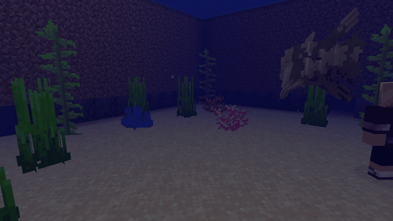
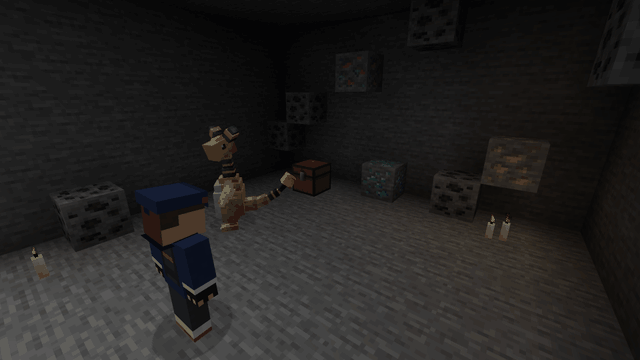
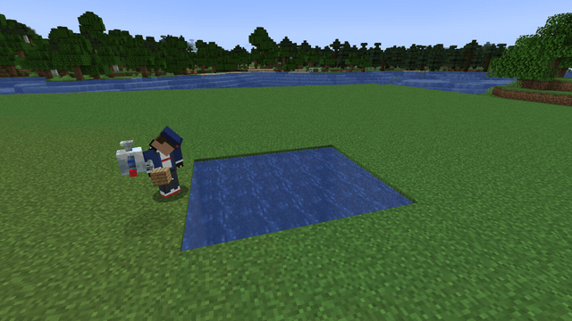
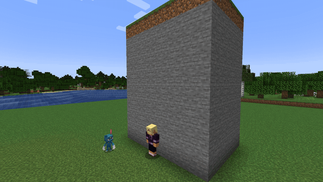
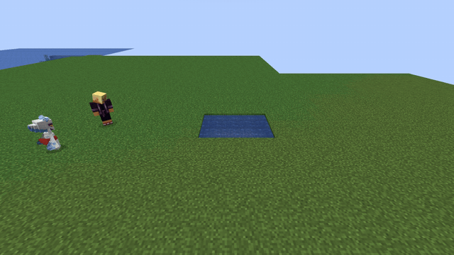
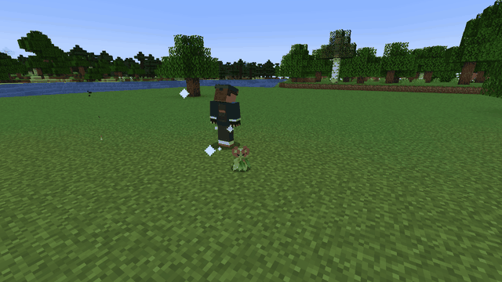
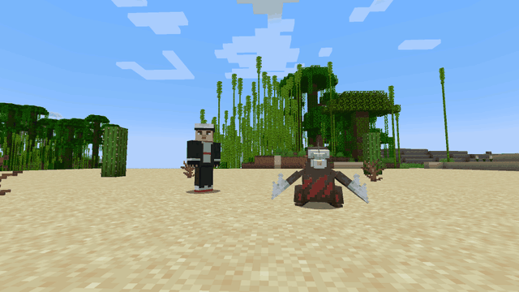
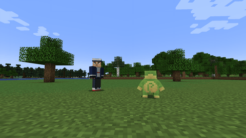
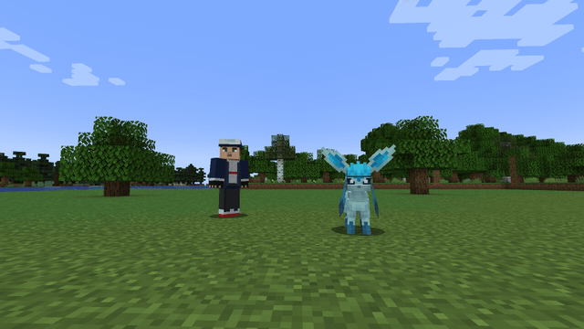

# Auras

Auras are **passive HMs your Pokémon give you** while they are out and near you (24 blocks). Open
Cobblemon's interaction wheel on one of your sent-out Pokémon, pick **Field moves**, and switch an
aura on; it shows **✔** while it is on. Walk away from the Pokémon and the aura pauses; it comes
back when you do.

You can run as many auras as you like, from one Pokémon or several. Each one costs the Pokémon
giving it a little **fullness** for every minute it stays on (see
[Keeping it fed](../pokemon.md#keeping-it-fed)).

**Put the Pokémon back in its ball and its auras switch off.** Sending it out again does not bring
them back: switch them on again from its wheel. Walking away from it only pauses them.

The toggles that make **a mount** better — Surf, Tailwind, Swift, U-turn, Endure and Agility —
belong to the Pokémon you ride: see [Your Pokémon](../pokemon.md#mount-toggles).

!!! tip "Active HMs on your HUD"
    The **top-left corner of your HUD lists every HM in effect**, grouped by kind — **Companion**
    (the HM lent to your fist), **Aura**, **Weather** and **Mount** — each with its own icon and the
    Pokémon doing it in brackets, by its nickname if it has one: for example *Sandstorm (Dunes)*.
    The interaction wheel shows the same list in its corner. Auras do not show as status effects.
    Hide the list with *Show active HMs on the HUD* in the config screen (Mod Menu on Fabric, the
    mod list's Config button on NeoForge), or `/hms config hud false` in singleplayer.

## Weather auras

!!! info "One weather at a time"
    **Rain Dance, Thunder, Sunny Day, Blizzard, Sandstorm and Mist** are weather. Only **one** runs at a time:
    switching one on, on any of your Pokémon, switches the others off, so the last one you switched
    on is the one in effect. Between players close together, too, the weather switched on last wins.
    Like any aura, a weather only works while its Pokémon is out and near you, and **putting the
    Pokémon back in its ball switches it off**.

    Every weather takes over **Minecraft's own sky** while it is on: Rain Dance makes it rain,
    Thunder brews a thunderstorm, and all the others keep it clear, so no rain falls through your
    sandstorm, mist or blizzard while their own effects run. Switch it off, or recall the Pokémon,
    and the game decides the weather again.

    **Snowscape is not a weather**: it is a plain aura (snow underfoot, nothing in the sky), so it
    runs alongside any of them.

---

## Who can give it

A Pokémon can give an aura when it **has learned the move**, one of its four or one it swapped
out. On a server that lets species count, these can always give it:

| Icon | Aura | Pokémon (any of) |
|---|---|---|
|  | Absorb | Gulpin, Swalot, Victreebel |
|  | Blizzard *(weather)* | Abomasnow, Glalie, Froslass |
|  | Dive | Vaporeon, Lapras, Wailord |
|  | Flash | Ampharos, Jolteon, Lanturn |
|  | Jump | Magikarp, Buneary, Spoink — or any Pokémon with **Splash** |
|  | Lava Plume | Magcargo, Slugma, Turtonator |
|  | Lucky Chant | Clefairy, Chimecho, Togetic |
|  | Magnet Rise | Magnemite, Magneton, Magnezone |
|  | Rain Dance *(weather)* | Politoed, Kyogre, Golduck |
|  | Rock Climb | Rhydon, Rhyperior, Sneasel |
|  | Shadow Sneak | Gengar, Banette, Spiritomb |
|  | Snowscape | Froslass, Mamoswine |
|  | Sunny Day *(weather)* | Torkoal, Sunkern, Volcarona |
|  | Sweet Scent | Gloom, Bellossom, Vileplume, Aromatisse |
|  | Thunder *(weather)* | Pikachu, Raichu, Zapdos |
|  | Sandstorm *(weather)* | Hippopotas, Hippowdon, Tyranitar, Gigalith, Sandaconda |
|  | Mist *(weather)* | Lapras, Lotad, Lombre, Ludicolo, Suicune — or any Pokémon with Mist |

---

## Ability details

###  Absorb
**Power:** magnet radius 6

Loose items on the ground drift toward you while it is on, so a scattered drop or a mined vein
gathers itself. Items are nudged rather than yanked, so they keep their normal pickup delay.

---

###  Dive

Lets you **live and work underwater**. Water stops getting in your way:

- **Breathe underwater** — never run out of air.
- **Walk the seabed as if it were dry land** — no wading, no drag on every step.
- **Mine at full speed** — a block underwater breaks as fast as the same block in open air, and
  the weight a guardian temple puts on your arms lifts while you're under.

Dive takes penalties away; it never hands out a bonus. Push off the bottom and you swim at exactly
the speed you always did — if you want to be *fast* in the water, ride a Pokémon with [Surf](../pokemon.md#mount-toggles) switched on.

---

###  Flash

Lets you **see clearly in the dark**, even in caves and at night. Toggle off to remove instantly.
It works with **Iris shader packs** too: the world itself gets brighter, not just the screen.

---

###  Jump
**Power:** Jump Boost level (default **IV**)

Comes from the move **Splash**, so any Pokémon that knows it can give it. Applies continuous
**Jump Boost**. The `power` value equals the buff level, so `power = 4` gives Jump Boost IV.

---

###  Lava Plume
**Power:** tenths of the movement multiplier (default 17)

Dive's twin for lava. It lets you **live and work down there**: you **do not burn**, you move
through lava and walk its floor without the fluid dragging on every step, and you breathe while you
are under. Swimming out is exactly as it always was — like Dive, it takes a penalty away rather than
handing out a bonus.

- **Fire:** you are **fire immune**, like a Strider: no damage, and no flames on your screen or
  on your body, in lava or out of it.
- **Seeing:** with your head under the lava you can see about 24 blocks instead of one, and the
  floor around you is lit. Wading with your head above the surface leaves the sky as it is.
- **Moving:** walking through lava is as quick as walking on land. Sprint and you swim, a little
  faster, but never faster than you sprint on land.
- **Breathing:** your air never runs out while you are under.

Like every aura it only works while its Pokémon is out and within 24 blocks. If it wanders off, goes
back in its ball or you switch the aura off, the fire protection lasts **5 more seconds** and you get
a warning if you are in lava, enough to climb out.

It used to need Burning Bulwark for the fire protection. Burning Bulwark went to Cobblemon Action
Combat, so Lava Plume now covers that on its own.

---

###  Lucky Chant

Fortune leans your way while it lasts: what you break and what you fish give up a little more.

---

###  Magnet Rise
**Power:** percent of creative flight speed you get (default **25**)

**Flight.** Switch it on and **double-tap jump** to lift off, as in creative mode. You stay up for as
long as you like, drifting at a little over half your walking pace, and sprinting gives no dash.
While it is on you take no fall damage.

It is a **building** tool, not a way to travel: for that, ride one of your flying Pokémon.

- **It ends when the aura does:** recall the Pokémon, switch it off, or get more than 24 blocks from
  it (flying straight up counts). If that happens in the air, you **float down on Slow Falling**
  until you land instead of dropping.
- Logging out while flying is safe: you come back floating down, and switch it on again once your
  Pokémon is out.
- It never touches a flight you have from somewhere else (creative mode, another mod, `/fly`).

---

###  Rock Climb

Every vertical surface behaves like a ladder, and it is steered by the **movement keys**: **W**
climbs, **S** descends, and holding nothing holds your place on the wall.

Your horizontal movement is left alone, so you can travel along a face and step off it whenever you
like — a wall is something to climb, not something to be stuck to. On the ground it only takes over
when you are actually asking to go up, so walking and jumping near a wall work normally.

**It works on your mount too.** Riding a Pokémon, run into a wall holding **W** and your Pokémon
climbs it with you.

---

###  Shadow Sneak
**Power:** percent of your speed you keep (default **55**)

Total stealth on foot. No footstep sounds, no name over your head, and **nothing underfoot notices
you** — not pressure plates, not tripwires, not a sculk sensor.

You move slower than a walk for it, though faster than a crouch, so it is something you can actually
travel in rather than a stationary hiding trick. **You cannot sprint on land** while it runs, and
climbing a ladder or vine makes no sound either.

It only works **on land**: in water or lava you swim at your normal speed, sprint-swimming included.

!!! note "If you are already on a scoreboard team"
    The hidden nametag is done with a vanilla team, so a player who already belongs to one keeps
    their team and simply does not get that part of the effect. Everything else still applies.

---

###  Snowscape
**Power:** trail radius 3

Winter follows you on foot: snow settles around you as you walk, and **still water freezes over** as
you cross it, the way Frost Walker does. Flowing water is left alone, so a river keeps running
instead of being paved, and the ice melts back once you have passed. Where it is too warm to snow
(a desert, a jungle, a plain), the snow melts away again shortly behind you; in a cold biome it stays.

- It works **only on foot**: not while you ride, swim or fall, so it never freezes the sea under a
  Pokémon you are surfing on.
- Only open water freezes. Kelp, seagrass and waterlogged blocks are left as they are, and no ice
  forms around a creature standing in the water.
- It changes only what you could change by hand: nothing in adventure mode, in spectator mode or
  inside spawn protection, and nothing on land a claim mod protects from you.

It is a plain aura, not a weather, so it runs alongside whichever weather is on.

---

###  Sweet Scent
**Cooldown:** 60s between arrivals

Works like a **Poké Snack you carry around**. While it is on, the Pokémon giving off the scent
gives off **pink dust**, and a wild Pokémon from the area turns up near it about once a minute. It uses Cobblemon's own spawner with the Poké Snack's rules, so what
arrives is what lives there, and it never brings a herd.

**The held item is the seasoning.** Whatever the Pokémon giving off the scent is holding works the
way that item would as a Poké Snack seasoning: a berry that leans a snack toward a type, a nature or
a shiny leans the scent the same way. Several Pokémon with Sweet Scent on add their items together,
like several seasonings in one snack. The item is not used up. A seasoning that makes a snack bite
sooner (a bite-time effect) makes the next arrival come sooner too, with the same chance it has in a
snack.

Arrivals follow the snack's limits: no more than Cobblemon's Poké Snack cap of wild Pokémon per
chunk around you, nothing arrives while you are dead or spectating, and the interval never drops
below 5 seconds whatever the config says.

---

###  Sandstorm
**Power:** how many times faster loose ground breaks (**4**)

Weather aura. **A sandstorm you can see** blows around you, in any biome and any dimension, and
every player nearby sees it too. The vanilla sky stays clear. Sand is your ground while it blows:

- **Soul sand and honey never slow you down**: you walk on them as fast as on stone. It works in the
  Nether too, so a soul sand valley is open ground.
- **Sand, gravel, soul sand, soul soil, clay and concrete powder break 4× as fast**, whatever you
  dig them with. Everything else breaks at its normal speed, so it never makes your pickaxe faster.
- Another player's weather switched on later, close to you, replaces your sandstorm until you move
  apart or theirs ends.

---

###  Mist
**Power:** blocks away a hunter loses you (**8**)

Weather aura, with a clear sky. A grey mist rolls in around you, the same everywhere, sky included,
and you can only see about 20 blocks. Anything hunting you
**loses track of you** once you are more than 8 blocks away, and goes back to wandering. Up close it
still sees you, so Mist is for slipping away, not for standing in the open.

Early in 4.0 this aura was called **Fog** and also came from Haze and Smokescreen; now it comes from
the move Mist. A config file that still says `fog` is read as Mist.

---

###  Rain Dance

Weather aura. **It rains**, the game's own rain, for as long as Rain Dance is on and its Pokémon is out.
Switch it off or recall the Pokémon and Minecraft takes the weather back.

**It rains wherever you are**: deserts, snowy biomes, the Nether and the End included. Within 16
blocks of you it is real rain for everything that asks: it puts out fires and burning mobs, lets
Riptide work, fills cauldrons, and counts for Cobblemon's rain spawns and rain evolutions.

---

###  Thunder

Weather aura. **It brews a thunderstorm**, for as long as Thunder is on and its Pokémon is out. It
rains wherever you are, exactly like [Rain Dance](#rain-dance), with thunder on top.

The moment you switch it on, **a bolt comes down 6 to 12 blocks away**. That opening bolt is only for
show: it flashes and booms but sets nothing alight and hurts nobody, so switching it on next to your
own base is safe. The storm's own lightning after that is the game's, and does what vanilla
lightning does.

---

###  Sunny Day

Weather aura. **The sky stays clear**, with no rain and no storms, for as long as Sunny Day is on and
its Pokémon is out. Switch it off or recall the Pokémon and Minecraft takes the weather back.

---

###  Blizzard
**Power:** radius of the snowfall around you (**24**)

Weather aura. **Snow falls and settles all around you**, whatever the biome, for as long as Blizzard is
on and its Pokémon is out. The sky stays clear of vanilla rain meanwhile. The snow is real snow: it
piles up to three layers and settles where a real snowfall would, on open ground, never on top of
flowers or grass and not right next to a torch.

**Where it is too warm to snow**, the snow melts on its own a few minutes after the storm has moved
on or been switched off, even across a server restart. Where the biome is cold enough to snow, it is
ordinary snow and stays.

It does not snow in the Nether (there is no sky there, only a roof), and it stops while you are in
spectator mode.

