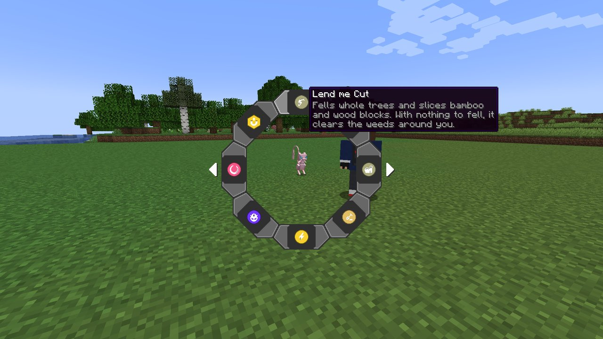
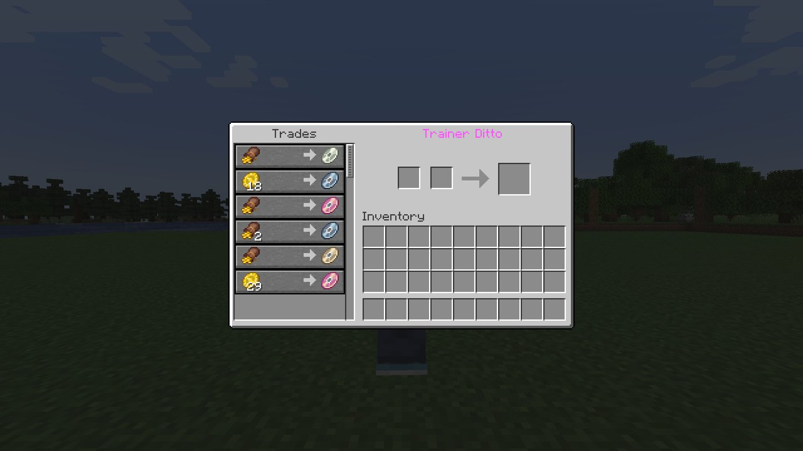

# Getting Started

Cobblemon HMs has nothing to learn, craft or carry. **Your Pokémon do the work.** If a Pokémon of
yours has learned a move, it can share it with you while it is out.

## Your Pokémon's wheel

Send out a Pokémon, open Cobblemon's **interaction wheel** on it and pick **Field moves**. The wheel
that opens lists everything that Pokémon can do for you, and nothing it cannot. Hover a slice and
its tooltip says what the HM does.

The slices are grouped by kind, clockwise from the top:

| Kind | What a pick does | Page |
|---|---|---|
| **Partner HM** | That Pokémon lends the move to your **empty fist** | [Partner HMs](abilities/active.md) |
| **Aura** | Switches a passive effect on you, on or off | [Auras](abilities/toggles.md) |
| **Weather aura** | Takes over the sky around you; one at a time | [Auras](abilities/toggles.md#weather-auras) |
| **Mount toggle** | Helps that Pokémon when you ride it | [Your Pokémon](pokemon.md#mount-toggles) |

A Pokémon can share an HM when it **has learned the move**: one of its four, or one it learned and
later swapped out. It has to be yours, sent out, and within 24 blocks. A server can loosen the rule
so that the move in its learnset, or its species, is enough; see
[Configuration](configuration.md#activation).

**Riding your own Pokémon, sneak + right-click** opens its Field moves without getting off, so you
can switch Surf, Agility and the rest mid-ride.

## Using a partner HM

Once a Pokémon is lending you an HM, **click with an empty hand** to fire it. Anything else in your
hand keeps its normal click, so tools, weapons and blocks behave exactly as they always did.

One Pokémon lends one HM at a time. Walk away from it and the HM pauses until you are back. **Put it
back in its ball and it stops lending**, and its auras switch off too, weather included: send
it out and switch them on again. Mount toggles stay on.

!!! tip "Getting your fist back"
    While an HM is lent, a bare-handed click fires it instead of punching. Open the Pokémon's wheel
    and pick the lent move again to hand it back, or simply recall the Pokémon.

The **top-left corner of your HUD** lists every HM in effect, grouped by kind, with the Pokémon
doing each one.

## What it costs

Nothing costs **you** anything. The **Pokémon** pays:

- **Fullness**, Cobblemon's berry bar: a quarter of a point each time you fire an HM it lends, and
  a fifth of a point a minute for each aura, weather or ridden mount toggle it keeps on.
- **A cooldown** on some partner HMs, kept per Pokémon, so a second Pokémon with the same move is
  ready straight away.

**Right-click your own Pokémon with any berry to feed it**: one berry, one point of fullness. A
Pokémon that works on an empty stomach keeps working, but it loses friendship for it, and at 0
friendship it refuses to do HMs. See [Your Pokémon](pokemon.md#keeping-it-fed).

---

## The Trainer Ditto

A rare wandering **Trainer Ditto** turns up now and then. You hear **Ditto's cry** when it arrives
near you; there is no chat message. Right-click it to open its stall.

- **The first time you meet one, it gives you an [HM Case](tm-bag.md)**, the bag for your TMs. The
  Case has no recipe: this is where it comes from.
- **It sells six random Cobblemon TMs a visit**, one of each, for **relic coins**, **relic coin
  pouches** and **relic coin sacks**. The later Pokémon learn a move, the dearer its TM and the
  rarer it turns up; TMs for moves no Pokémon learns by levelling up are the dearest of all.
- **It turns up at random**, about every 30 minutes on average for the whole server, and stays about
  5 minutes before it wanders off.

Every price is in a file the server owner can edit; see
[Configuration](configuration.md#trainer-ditto).

**It is a Ditto in a coat.** Throw a Poké Ball and you catch it like any other, but every trader
after that keeps its distance and **will not open its stall for you again**, and beating one in
battle does the same, so weigh the shop against the Ditto. How good that Ditto is is the server's
call, and **out of the box it rolls its IVs like any other**: guaranteed perfect stats are an option
an operator turns on, not something the trader comes with.

**It is shiny at Cobblemon's own odds**, and wears a shiny costume. Once caught it is an
**ordinary, non-shiny Ditto**: the shine was the costume, not the prize.

Each trader wears a random player skin, and keeps it for as long as it stands there.

??? note "For resource pack makers: adding faces"
    Every PNG under `assets/cobblemon_hms/textures/entity/trainer_ditto/` is in the pool, so a
    resource pack adds a face by dropping a file in. A file whose name contains `shiny` is kept for
    the shiny trader.
