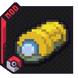

{ .hero-logo }

# Cobblemon HMs

Your Pokémon lend you their moves. Send one out and it cuts trees, smashes rocks and lights caves
with your bare fist, gives you auras like Flash, Dive and Rock Climb while it stays near you, or
brings its own weather.

<!-- mod-badges -->

[Get started](getting-started.md){ .md-button }
[Every HM](abilities/active.md){ .md-button }

## How it works

1. **Send out a Pokémon** and open Cobblemon's interaction wheel on it.
2. Pick **Field moves**: it lists every HM whose move that Pokémon **has learned**.
3. **Partner HMs** go to your **empty fist**: one at a time, fired with a click.
4. **Auras** and **weather** run on you while the Pokémon is out and within 24 blocks.
5. **Mount toggles** help the Pokémon itself while you ride it.
6. Nothing to learn and nothing to carry. Working makes the Pokémon **hungry**, so keep a few
   berries on you.

!!! abstract "4.0: the companion model"
    Ditto HMs is now **Cobblemon HMs**. You no longer learn HMs: every HM comes from a Pokémon of
    yours that knows the move, working costs it fullness, the Trainer Ditto sells TMs, and the HM
    Case is a TM bag. [What changed](upgrading-to-4.md).

---

## Quick links

| | |
|---|---|
| [Getting Started](getting-started.md) | First steps and the Trainer Ditto |
| [Partner HMs](abilities/active.md) | What your Pokémon lends your empty fist |
| [Auras](abilities/toggles.md) | The passives your Pokémon give you |
| [Your Pokémon](pokemon.md) | Feeding it, and the mount toggles that help the Pokémon you ride |
| [Upgrading to 4.0](upgrading-to-4.md) | What changed, and what happened to your save |
| [HM Case](tm-bag.md) | A bag for every TM you own |
| [Configuration](configuration.md) | Cooldowns, power, upkeep and the Trainer Ditto |
| [Commands](commands.md) | Admin and player commands |
| [Community Credits](credits.md) | The people who shape the mod |

---

## Get it

<!-- mod-spec -->

One jar per loader. New here? Start with **[Getting Started](getting-started.md)**.
