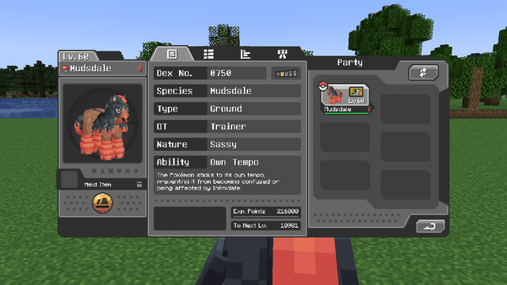
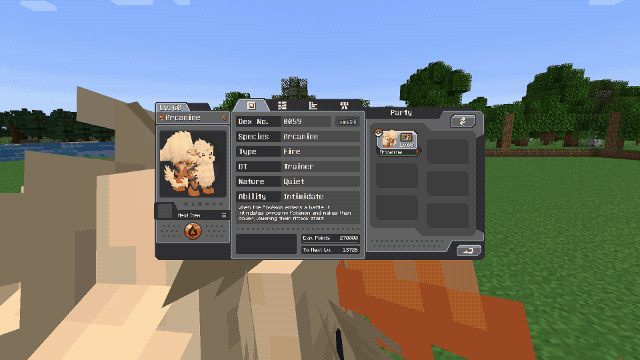
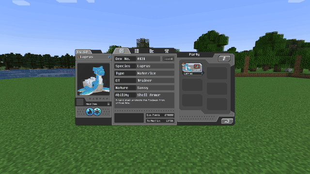
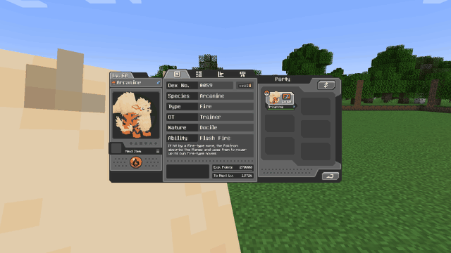

# Your Pokémon

Everything in Cobblemon HMs comes from **your Pokémon**. Send one out, open Cobblemon's
**interaction wheel** on it and pick **Field moves**. The second wheel lists everything that Pokémon
can do for you:

- **Partner HMs** it can lend your empty fist: see [Partner HMs](abilities/active.md).
- **Auras** and **weather** it can give you while it is out and near you: see
  [Auras](abilities/toggles.md).
- **Mount toggles** that help it when you ride it: below.

A Pokémon can do any of these when it **has learned the move**: one of its four, or one it learned
and later swapped out. A server that turns off *Pokémon must have learned the move*
([Configuration](configuration.md#activation)) also lets the move in its learnset, or its species
(the ones listed on these pages), count.

## Keeping it fed

Working makes a Pokémon hungry. It pays in **fullness**, Cobblemon's own berry bar:

| What it does | What it costs, by default |
|---|---|
| Each time you fire an HM it lends you | a quarter of a point of fullness |
| Each minute an aura, a weather or a mount toggle of its stays on (a mount toggle only while you ride it) | a fifth of a point, for each one |

A Pokémon holds 2 to 7 points of fullness, by its weight, so a berry covers about four uses or five
minutes of one aura.

**Right-click your own Pokémon with any berry to feed it**: one berry, one point of fullness, and you
hear it eat. Oran, Sitrus, Lum and the other berries Cobblemon already uses still heal or cure as
before when they would, and feed it too. Sneak + right-click still opens the interaction wheel.

**At 0 fullness it keeps working**, so nothing switches off in the middle of a cave. But each point
it cannot pay costs it **5 friendship**, and it sulks while that happens. **At 0 friendship it
refuses to do HMs** until its friendship comes back up.

Operators can change every one of these numbers, world-wide or for each HM on its own, or switch the
upkeep off: see [Configuration](configuration.md#pokemon-upkeep).

## Mount toggles

The toggles that make a ride better belong to the **Pokémon you ride**. Open the same **Field moves**
wheel on it and switch them on there; a toggle that is on shows **green**. They stay on for that
Pokémon, not for you and not for your other mounts, and help it whenever it is ridden. Putting it
back in its ball does not switch them off.

**Already riding?** Sneak + right-click opens your mount's Field moves without getting off.

| Icon | Toggle | Pokémon (any of) | While it is on |
|---|---|---|---|
|  | Surf | Lapras, Gyarados, Milotic | It cuts through water much faster. |
|  | Tailwind | Pidgeot, Noivern, Staraptor | It moves noticeably faster through the air. |
|  | Swift | Ninjask, Accelgor, Electrode | It gets up to speed twice as quickly. |
|  | U-turn | Yanma, Ninjask, Venipede | It turns far more sharply, on land, in water and in the air, up to the best handling a mount can have. Gliders, helicopters and burst swimmers have no handling stat, so it does nothing for them. |
|  | Endure | Mudbray, Mudsdale, Tauros | Its **Stamina** doubles, up to the best a mount can have (100), so it runs, swims or flies longer before it tires. |
|  | Agility | Arcanine, Zebstrika, Cyclizar | It runs faster on land. |

The species listed are the ones that can always do it when the server lets species count; any
Pokémon that has learned the move can do it.

The [Jump](abilities/toggles.md#jump) and [Rock Climb](abilities/toggles.md#rock-climb) auras also
carry over to whatever you are riding.

!!! note "Endure was Helping Hand"
    Before 4.0 this toggle was **Helping Hand**, and it cut how fast the stamina bar drained. It is
    **Endure** now and raises the Stamina stat itself. A config file or a save that
    still says `helping_hand` is read as Endure.

### What the Ride tab shows

Open the Pokémon's summary while a mount toggle is on and the **Ride** tab draws what your HMs add as
its own layer: the Pokémon's own stats in the usual solid shape, and the boost on top of it in the
same colour, lighter, with a dotted outline. The numbers around the chart read the boosted value.

