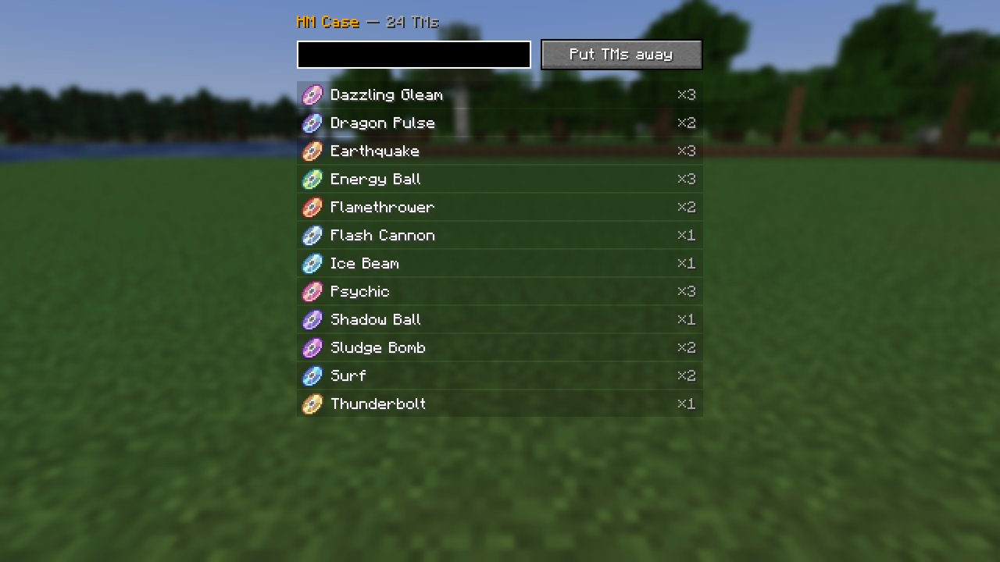

# HM Case (TM bag)

Since 4.0 the **HM Case** is a bag for **Cobblemon TMs**. It holds as many as you like, of as many
moves as you like, in one slot.

**You get one from the [Trainer Ditto](getting-started.md#the-trainer-ditto)** the first time you
meet one: it is no longer crafted. Right-click with the Case in hand to open it.

| Do | What happens |
|---|---|
| **Put TMs away** | Every TM in your inventory goes into the bag |
| **Click** a row | Takes one TM of that move out |
| **Shift-click** a row | Takes the whole stack out |
| Type in the **search box** | Filters the list by move name |

The Case's tooltip shows how many TMs are inside. A TM taken out that does not fit in your
inventory stays in the bag, so nothing is ever dropped.

The contents are stored on the Case itself, so it keeps them when you put it in a chest or hand it
to a friend.

!!! tip "Where TMs come from"
    The [Trainer Ditto](getting-started.md#the-trainer-ditto) sells six random TMs for relic coins,
    pouches and sacks every time it visits.
