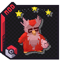

{ .hero-logo }

# Cobblemon Defeated Catch Chance

**Beat it, then catch it.** In Cobblemon a wild Pokémon you knock out is gone the moment the battle
ends. With this mod it stays down for a moment, asleep and on its last HP, and one good throw can
still bring it home.

There is nothing to learn. Install it and win a wild battle. (Operators can
[tune it](commands.md), and turn each part off.)

<!-- mod-badges -->

[Get started](getting-started.md){ .md-button }
[How it works](how-it-works.md){ .md-button }

!!! warning "Not released yet"
    Defeated Catch Chance has no public download yet. These pages describe the current development
    build, **0.0.6**. Anything not described here is not in the mod yet.

## Highlights

- 💤 **[It stays down](how-it-works.md#the-window)**: a wild Pokémon a player beats lies on the ground,
  asleep at 1 HP, instead of vanishing.
- ⏱️ **[One last chance](how-it-works.md#the-window)**: 60 seconds by default to throw a Poké Ball at
  it, and everyone nearby is told it is down.
- 🎯 **[Easy odds](how-it-works.md#why-it-is-easy-to-catch)**: asleep and on 1 HP, it is as easy to
  catch as Cobblemon's capture formula allows.
- 🏃 **[A miss wakes it](how-it-works.md#a-missed-ball)**: it sprints away from you, fades out and is
  gone. Balls thrown at it while it runs catch nothing.
- 🚫 **[No rematch](how-it-works.md#no-rematch)**: a downed Pokémon can be caught, never battled again.
- 💾 **[Survives a restart](how-it-works.md#a-save-and-reload)**: the window keeps counting through a
  save and reload.
- 🔧 **[Commands & Config](commands.md)**: the window's length, the flee's length, and an on/off
  switch for each, in game.

## Get it

<!-- mod-spec -->

No public download yet. New here? Start with **[Getting Started](getting-started.md)**.
