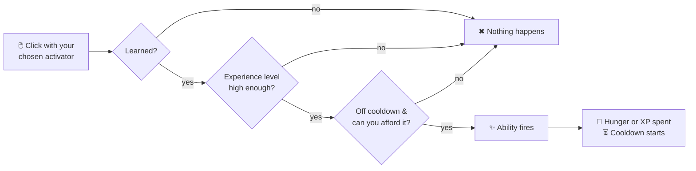

# Active HMs

Active HMs are fired on demand: pick one in the [HM wheel](../hm-wheel.md), then click with an
empty hand or the HM Case. Since **4.0** there are nine of them — the ones that are about moving
through the world and shaping it. The rest live on [your Pokémon](../pokemon.md) now, or went to
[Cobblemon Action Combat](../upgrading-to-4.md#what-went-where). Each use costs **hunger or experience** — whichever the server asks for —
and most start a cooldown.

---

## Acquisition table

Any one of the listed Pokémon can teach the HM — including the species that taught an HM merged into it. Hold the trigger item and **sneak + right-click** the Pokémon.

| Disc | HM | Pokémon (any of) | Trigger item |
|---|---|---|---|
|  | Camouflage | Zorua, Kecleon, Ditto | Ink Sac |
|  | Charge | Elekid, Electabuzz, Electivire | Redstone Dust |
|  | Cut | Scyther, Scizor, Kartana, Kleavor, Vikavolt | Stick |
|  | Leafage | Bulbasaur, Chikorita, Treecko, Snivy, Drilbur, Excadrill | Dandelion |
|  | Rock Smash | Hitmonchan, Machop, Geodude, Diglett, Dugtrio, Trapinch | Flint |
|  | Stockpile | Gulpin, Swalot, Squirtle, Totodile, Mudkip, Camerupt, Magcargo, Heatran | Sponge |
|  | Strength | Machoke, Machamp, Conkeldurr | Iron Ingot |
|  | Tail Whip | Rattata, Sentret, Buneary | Brush |
|  | Teleport | Abra, Kadabra, Alakazam, Ralts | Ender Pearl |

---

## Ability details

###  Camouflage
**Hunger:** 3 · **Cooldown:** 15 min · **Power:** 18000t (**15 minutes**)

Become the **living creature** you're looking at. Your model is replaced by theirs — species, form,
variant, gear and its nametag — for everyone who can see you.

- Aim at a **creature** in clear view → you look exactly like it for 15 minutes.
- **Fire it again while you are wearing one** → the costume comes off and the HM is ready
  immediately, so changing disguise is two presses.
- A block, a wall between you and it, or empty air → nothing happens. You can only copy something
  you can actually see.
- Other **players** can't be copied.

The disguise is a costume, not a creature: nothing extra exists in the world, so there is nothing
to hit, nothing in your way, and nothing that can be killed off you.

---

###  Charge
**Hunger:** 2 · **Cooldown:** 3s · **Power:** 200t (**10 seconds**)

Turns the block you aim at into a redstone power source — enough to throw a door, a piston or a
lamp from across a room. **It does not run out.** The charge ends when you charge something else or
leave, and never on a timer: a power source that switches itself off after a minute is not a power
source, it is a fault to go and find.

The block is never replaced — it stays exactly what it is and simply *answers* as a power source —
so you can charge a chest, a furnace, a statue or a wall without losing anything. While it is live
it throws off **electric sparks**, so a charged block is one you can find again.

---

###  Cut
**Hunger:** 2 · **Cooldown:** none · **Power:** max 128 blocks

Aim at a **log** and the whole tree comes down — every connected log, with the leaves and vines
tangled in it. Aim at a **leaf** or a **vine** and just that tangle goes.

It also **cuts plants**: grass, ferns, crops, ground cover. Those come away as if you had used
shears, so the drops are the careful ones — the grass itself rather than a couple of seeds — and
that holds for plants added by a datapack too, because it is the game's own loot tables answering.

**With nothing to cut in front of you, it clears the ground around you** (this is what X-Scissor
used to do), in two passes of decreasing politeness:

1. **Weeds first** — grass, ferns, dead bushes. If there are any, that is all it touches.
2. **Then what somebody planted** — flowers and crops, and *only* once there is not a single weed
   left in range (radius 5). Casting by accident in your own wheat field costs you the weeds, not
   the field.

It never strips grass down to dirt: as a fallback, that would go off every time you missed a tree.

Felling a tree and cutting a plant both cost hunger. A single isolated log, and shearing a sheep,
are free.

---

###  Leafage
**Hunger:** 1 · **Cooldown:** 2s · **Power:** radius 5

Instantly grows **every crop around you** to full maturity — handy for fast harvests — and does
the same for saplings and berry trees.

The bare ground answers too, and it answers in **flowers**: a burst leaves a meadow rather than a
lawn, with the odd blade of grass among it. The blooms are ones that belong to the biome you are
standing in, so a burst in a plains looks nothing like one in a flower forest — and a biome with no
flowers of its own gets grass rather than a dandelion that does not belong there.

It only ever plants on **bare ground**. A spot that already has something growing on it is left
exactly as it stands, so casting twice in the same meadow thickens it instead of disturbing it, and
tall flowers are planted whole rather than as a half that topples.

**Crouch while you use it to till instead** (this is what Rototiller used to do): the dirt-type
block you aim at — Dirt, Grass Block, Coarse Dirt, Dirt Path — turns into Farmland.

---

###  Rock Smash
**Hunger:** 2 · **Cooldown:** none · **Power:** max 32 ores

Instantly breaks the block you aim at. If it's an **ore**, vein-mines all connected ore of that
type; otherwise breaks the single pickaxe-minable block (Netherite Pickaxe drops).

It **digs** too (this is what Dig used to do): dirt, sand, gravel and anything else a shovel takes
come out in one hit, free, with a Netherite Shovel's drops.

---

###  Stockpile
**Hunger:** 1 · **Cooldown:** 1s · **Power:** lava self-damage 7 (3.5 hearts)

Stockpile is a mouthful you keep. It took over **Water Gun** and **Eruption**.

- **Aim at water or lava** (source or flowing) and you **drink it**. The pool is drained, and that
  fluid is now what you carry. Water is free; **lava is spicy** and burns going down.
- **Aim anywhere else** and you **spit it back out** on the face you are aiming at — the same square
  a bucket would fill. You can spit **as often as you like**: what you carry only changes when you
  drink the other fluid.
- Spitting water at a **sponge** soaks it.

It passes the same permission check a bucket does, so claims, spawn protection and the world border
all hold. Lava is never placed at your own feet, and water boils away in the Nether, as it would
from a bucket.

---

###  Strength
**Hunger:** 2 · **Cooldown:** none

Pushes the aimed block one block in whichever of the six directions you're looking — up and down
included. Containers travel with their contents, and a **double chest moves as one unit**: both
halves go together, or the push fails if either has nowhere to go. Won't move fluids.

---

###  Tail Whip
**Hunger:** 2 · **Cooldown:** 2s

Sweeps a **suspicious sand or gravel** block clean in a single motion instead of a dozen slow ones,
and finds exactly what a brush would have found. **Rooted dirt** counts too: it is not brushable in
vanilla, but it is the same gesture on the same kind of thing, so it gives up its hanging roots.

---

###  Teleport
**Hunger:** 6 · **Cooldown:** 30s · **Power:** max 30 blocks

Blinks you to the block you're looking at (≤ 30 blocks), finding the nearest safe landing. Plays
the Enderman teleport sound.

It is the strongest way to travel the mod has, so it is priced like it: dearer than anything else
you fire, and slow to come back.

---
