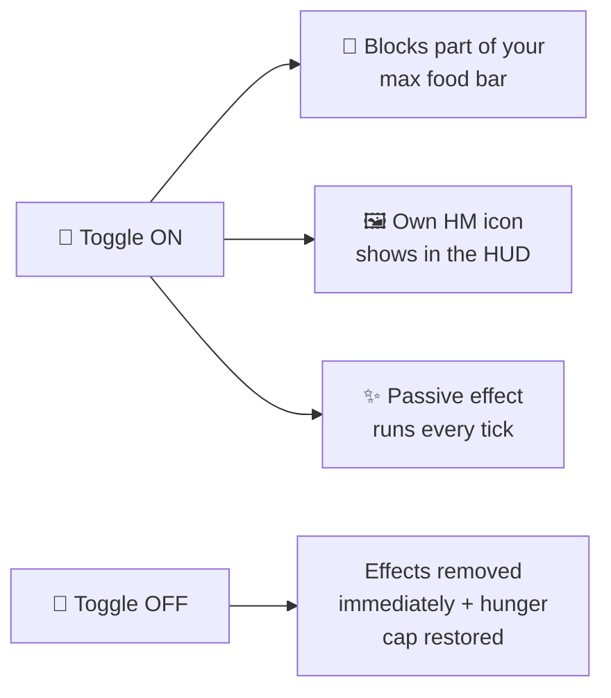

# Toggle HMs

Toggle HMs are **passive abilities** that stay active until you turn them off.
Switch them on from the inner ring of the [HM wheel](../hm-wheel.md), or with `/dittohm use <id>`.

The toggles that made **a mount** better — Surf, Tailwind, Swift, U-turn, Helping Hand and Agility —
belong to the Pokémon you ride since 4.0: see [Your Pokémon](../pokemon.md#mount-toggles).

!!! tip "HUD icons"
    Every enabled toggle shows its **own HM status-effect icon** in your HUD (top-right), so
    it's obvious at a glance which toggles are on. Wherever the game has an equivalent attribute,
    the toggle uses that instead of a status effect, so the HM entry is the only one in your
    inventory rather than a hidden duplicate sitting next to it.

---

## Hunger cost

Each enabled toggle **blocks food points** from your maximum food bar. Most block 2; **Fly** and
**Shadow Sneak** block 3, and **Magnet Rise** a full **15** — flight costs nearly the whole
budget, which is the point of it.
At your effective cap a slow **Regeneration I** effect keeps you healing normally.
The cap never drops below **2**.

| Food points blocked | Max hunger |
|---|---|
| 0 | 20 / 20 |
| 2 | 18 / 20 |
| 4 | 16 / 20 |
| 6 | 14 / 20 |
| 8 | 12 / 20 |
| … | … |
| 18+ | 2 / 20 (floor) |

When a toggle is turned **off**, its effects are removed **immediately**.

---

## Acquisition

| Disc | HM | Pokémon (any of) | Trigger item |
|---|---|---|---|
|  | Absorb | Gulpin, Swalot, Victreebel | Hopper |
|  | Dive | Vaporeon, Lapras, Wailord | Nautilus Shell |
|  | Flash | Ampharos, Jolteon, Lanturn | Glowstone Dust |
|  | Fly | Pidgeot, Charizard, Dragonite, Togekiss, Aerodactyl | Phantom Membrane |
|  | Jump | Magikarp, Buneary, Spoink | Raw Cod |
|  | Lava Plume | Magcargo, Slugma, Turtonator | Magma Cream |
|  | Lucky Chant | Clefairy, Chimecho, Togetic | Emerald |
|  | Magnet Rise | Magnemite, Magneton, Magnezone | Iron Nugget |
|  | Rock Climb | Rhydon, Rhyperior, Sneasel | Chain |
|  | Shadow Sneak | Gengar, Banette, Spiritomb | Black Dye |
|  | Snowscape | Froslass, Mamoswine | Blue Ice |

---

## Ability details

###  Absorb
**HungerBlock:** 2 · **Power:** magnet radius 6

 — how it shows in your status bar while it runs.

Loose items on the ground drift toward you while it is on, so a scattered drop or a mined vein
gathers itself. Items are nudged rather than yanked, so they keep their normal pickup delay.

---

###  Dive
**Blocks:** 2

 — how it shows in your status bar while it runs.

Lets you **live and work underwater**. Water stops getting in your way:

- **Breathe underwater** — never run out of air.
- **Walk the seabed as if it were dry land** — no wading, no drag on every step.
- **Mine at full speed** — a block underwater breaks as fast as the same block in open air, and
  the weight a guardian temple puts on your arms lifts while you're under.

Dive takes penalties away; it never hands out a bonus. Push off the bottom and you swim at exactly
the speed you always did — if you want to be *fast* in the water, ride a Pokémon with [Surf](../pokemon.md#mount-toggles) switched on.

---

###  Flash
**Blocks:** 2

 — how it shows in your status bar while it runs.

Lets you **see clearly in the dark**, even in caves and at night. Toggle off to remove instantly.

---

###  Fly
**Blocks:** 3 · **Take-off:** 3 hunger, 1s cooldown

 — how it shows in your status bar while it runs.

Fly is a toggle now, and it took over **Glide**.

- **Switch it on and you glide** after any jump or fall — the real Elytra gliding, without needing
  the item. Dive to gain speed, level off to glide far.
- **Press jump again in mid-air to take off**: a big launch upwards, or, if you are already
  climbing, a firework-style boost towards where you are looking. Each launch costs hunger and has
  a short cooldown.

!!! warning "Fly or Magnet Rise, not both"
    Switching Fly on switches **Magnet Rise** off, and the other way round. Fly is for travelling;
    Magnet Rise is a slow hover for building.

---

###  Jump
**Blocks:** 2 · **Power:** Jump Boost level (default **IV**)

 — how it shows in your status bar while it runs.

Applies continuous **Jump Boost**. The `power` value equals the buff level, so `power = 4` gives Jump Boost IV. Shows in your HUD.

---

###  Lava Plume
**Blocks:** 2 · **Power:** tenths of the movement multiplier (default 17)

 — how it shows in your status bar while it runs.

Dive's twin for lava. It lets you **live and work down there**: you **do not burn**, you move
through lava and walk its floor without the fluid dragging on every step, and you breathe while you
are under. Swimming out is exactly as it always was — like Dive, it takes a penalty away rather than
handing out a bonus.

It used to need Burning Bulwark for the fire protection. Burning Bulwark went to Cobblemon Action
Combat, so Lava Plume now covers that on its own.

---

###  Lucky Chant
**Blocks:** 2

 — how it shows in your status bar while it runs.

Fortune leans your way while it lasts: what you break and what you fish give up a little more.

---

###  Magnet Rise
**Blocks:** 15

 — how it shows in your status bar while it runs.

**Flight.** Switch it on and you are off the ground for as long as you like, drifting at half your
walking pace with no dash.

The price is the steepest of any toggle and it is paid once: **fifteen** food points off your
maximum, out of a budget of eighteen. Flying is very nearly everything you have, which is the
point.

It is a **building** tool, not a way to travel: for that there is [Fly](#fly), and the two cannot run
together — switching one on switches the other off.

---

###  Rock Climb
**Blocks:** 2

 — how it shows in your status bar while it runs.

Every vertical surface behaves like a ladder, and it is steered by the **movement keys**: **W**
climbs, **S** descends, and holding nothing holds your place on the wall.

Your horizontal movement is left alone, so you can travel along a face and step off it whenever you
like — a wall is something to climb, not something to be stuck to. On the ground it only takes over
when you are actually asking to go up, so walking and jumping near a wall work normally.

**It works on your mount too.** Riding a Pokémon, run into a wall holding **W** and your Pokémon
climbs it with you.

---

###  Shadow Sneak
**Blocks:** 3 · **Power:** percent of your speed you keep (default **55**)

 — how it shows in your status bar while it runs.

Total stealth on foot. No footstep sounds, no name over your head, and **nothing underfoot notices
you** — not pressure plates, not tripwires, not a sculk sensor.

You move slower than a walk for it, though faster than a crouch, so it is something you can actually
travel in rather than a stationary hiding trick.

!!! note "If you are already on a scoreboard team"
    The hidden nametag is done with a vanilla team, so a player who already belongs to one keeps
    their team and simply does not get that part of the effect. Everything else still applies.

---

###  Snowscape
**HungerBlock:** 2 · **Power:** trail radius 3

 — how it shows in your status bar while it runs.

Winter follows you on foot: snow settles around you as you walk, and **still water freezes over** as
you cross it. Flowing water is left alone, so a river keeps running instead of being paved.

---
