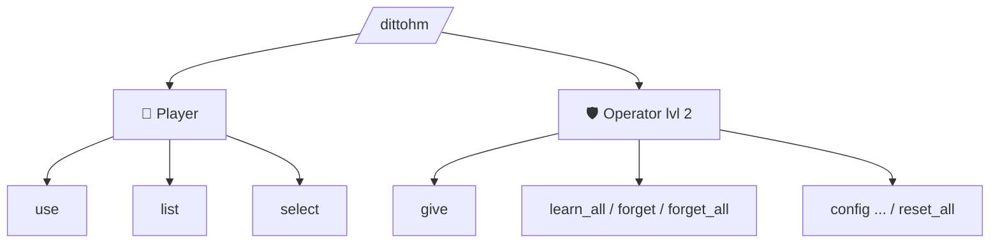

# Commands

The command root is `/dittohm`.



## Player commands

```
/dittohm use <ability>
```
Activates an ability you have learned (or toggles a passive on/off).

```
/dittohm list
```
Shows every ability with your learn status, toggle state, and configured hunger/cooldown.

```
/dittohm select <ability>
/dittohm select none
```
Selects an active HM without opening the [HM wheel](hm-wheel.md), or clears the selection.

---

## Operator commands

Require **permission level 2**:

!!! note "Every command takes an optional player"
    `give`, `learn`, `select`, `forget`, `forget_all` and both `trader` actions accept a trailing
    `[player]`. Leave it off and the command applies to you.

```
/dittohm give <ability> [player]
```
Gives the HM Disc for the specified ability — the operator's way in. Right-clicking the
disc teaches the HM, the same as one earned in survival.

```
/dittohm learn <ability> [player]
```
Teaches the ability outright, with no disc involved.

```
/dittohm trader spawn [player]
/dittohm trader forget [player]
```
Summons a Trainer Ditto on demand, or undoes a catch so it will visit that player again.

```
/dittohm learn_all [player]
```
Instantly learns **every HM** (the 20 that are still the player's) for a player (does **not** auto-enable toggles).

```
/dittohm forget <ability> [player]
/dittohm forget_all [player]
```
Unlearns one or all HMs.

```
/dittohm config <ability> hunger <0–20>
/dittohm config <ability> cooldown <0–24000>
/dittohm config <ability> power <0–512>
/dittohm config <ability> hungerblock <0–20>   (toggles only)
/dittohm config <ability> reset
/dittohm config reset_all
```

!!! tip "After updating to 4.0"
    There is nothing to reset. Every save is migrated the first time each player joins — see
    [Upgrading to 4.0](upgrading-to-4.md). Retired HMs no longer answer any command.

---

## Ability IDs

### Active

| ID | Display name |
|---|---|
| `leafage` | Leafage |
| `cut` | Cut |
| `rock_smash` | Rock Smash |
| `camouflage` | Camouflage |
| `strength` | Strength |
| `teleport` | Teleport |
| `stockpile` | Stockpile |
| `charge` | Charge |
| `tail_whip` | Tail Whip |

### Toggle

| ID | Display name |
|---|---|
| `magnet_rise` | Magnet Rise |
| `fly` | Fly |
| `jump` | Jump |
| `dive` | Dive |
| `flash` | Flash |
| `rock_climb` | Rock Climb |
| `lava_plume` | Lava Plume |
| `snowscape` | Snowscape |
| `absorb` | Absorb |
| `lucky_chant` | Lucky Chant |
| `shadow_sneak` | Shadow Sneak |
