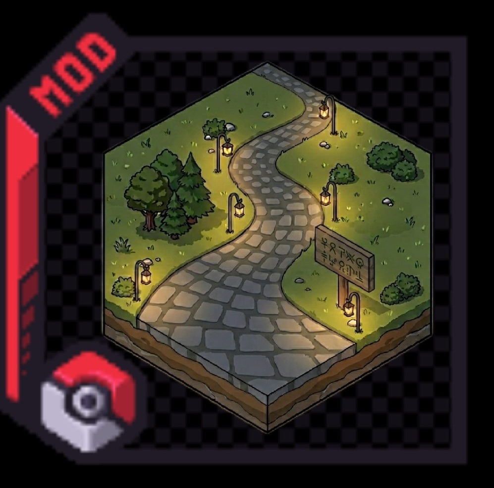
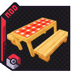
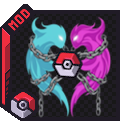
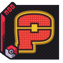
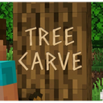

---
hide:
  - navigation
  - toc
---

# Cobblemon mods by shiero

Mods that turn a Cobblemon world into an adventure: roads and towns worth exploring, a Nuzlocke
that enforces itself, a picnic table that bends the spawns, every HM in your own hands, every raid
den on your map, a team you train yourself, one that grows in the middle of the fight, and messages
cut into the trees. Documentation for all of them lives here.

[Browse the mods](#the-mods){ .md-button }
[Report a bug](#found-a-bug-or-have-an-idea){ .md-button }
[Discord](https://discord.gg/SwcwXcCN4k){ .md-button }

## The mods

-   [{ .mod-logo }](routes/index.md)

    ### [Routes](routes/index.md)

    Worldgen roads that connect the structures already in your world, plus named routes, areas and
    towns, and full Xaero map integration. The world stops being a random field and starts being a
    region. Works with or without Cobblemon.

    [Getting started →](routes/getting-started.md)

    MC 1.21.1 Fabric NeoForge

-   [{ .mod-logo }](picnic/index.md)

    ### [Cobblemon Picnic](picnic/index.md)

    A picnic table that re-rolls the wild spawns around it on demand — hunt a shiny or a specific
    Pokémon without walking the map raw. Doubles as a social spot: shiny aura, Pokémon care and
    trainer battles.

    [Getting started →](picnic/getting-started.md)

    MC 1.21.1 Fabric NeoForge

-   [{ .mod-logo }](ditto-hms/index.md)

    ### [Cobblemon Ditto HMs](ditto-hms/index.md)

    Become the HM slave you always made suffer: **75 Pokopia-inspired abilities** you learn
    yourself — Cut, Fly, Surf, Teleport and more — powered by hunger instead of a party slot.

    [Getting started →](ditto-hms/getting-started.md)

    MC 1.21.1 Fabric NeoForge

-   [{ .mod-logo }](nuzlocke/index.md)

    ### [Cobblemon Nuzlocke & Soul Link](nuzlocke/index.md)

    A Hardcore Nuzlocke the game enforces for you: one catch per zone, permadeath, mandatory
    nicknames, level caps — plus **Soul Link**, where linked parties share fates.

    [Read the rules →](nuzlocke/nuzlocke.md)

    MC 1.21.1 Fabric NeoForge Requires Routes

-   [{ .mod-logo }](raid-icons/index.md)

    ### [Cobblemon Raid Icons](raid-icons/index.md)

    Every Cobblemon Raid Dens crystal drawn on your minimap and world map as its **tera type icon**,
    with a tooltip naming the Pokémon inside. Client-side: install it and play on any server.

    [Getting started →](raid-icons/getting-started.md)

    MC 1.21.1 Fabric NeoForge Client-side

-   [{ .mod-logo }](champions/index.md)

    ### [Cobblemon Champions Training](champions/index.md)

    Effort values step aside for **stat points**, the Pokémon Champions way: spent from the summary
    screen, paid for with your own experience, with nature, ability and moves retrained alongside.

    [Getting started →](champions/getting-started.md)

    MC 1.21.1 Fabric NeoForge

-   [{ .mod-logo }](mid-battle-exp/index.md)

    ### [Cobblemon Mid-Battle EXP](mid-battle-exp/index.md)

    Experience at **every knockout**, the way the main series pays it. A level gained mid-battle
    counts in that same battle — new stats, more HP — and a new move is yours before the next turn.

    [How it works →](mid-battle-exp/how-it-works.md)

    MC 1.21.1 Fabric NeoForge No config

-   [{ .mod-logo }](tree-carve/index.md)

    ### [Tree Carve](tree-carve/index.md)

    Sneak and right-click a log with a sword to cut a message into the bark: text, symbols and
    colour, arranged on the face like a canvas. Plain Minecraft, no Cobblemon needed.

    [Getting started →](tree-carve/getting-started.md)

    MC 1.21.1 MC 26.1 – 26.3 Fabric NeoForge

## Start here

-   ### :material-download: Installing

    Every mod runs on **Minecraft 1.21.1** on either **Fabric** or **NeoForge**. Drop the jar for your
    loader into `mods/` — never both jars at once.

    The Cobblemon mods also need **Cobblemon**; each one's *Getting Started* page names the version.
    **Routes and Tree Carve do not.** Tree Carve also runs on Minecraft 26.1 to 26.3, with a jar for
    each version.

    Each mod's *Getting Started* page lists its own dependencies.

-   ### :material-tune: Configuring

    Routes and Nuzlocke are set up on the **world-creation screen** and stored with that world.
    Picnic, Ditto HMs and Raid Icons use in-game config: a command, or a settings screen. Tree Carve
    is set by operators with `/treecarve config`. Mid-Battle EXP has nothing to configure.

    See each mod's *Configuration* page.

-   ### :material-map-search: Finding things

    Every section follows the same order: **Getting Started**, the mod's own feature pages,
    **Commands**, **Configuration**, **Community Credits**.

    The search box at the top covers every mod at once.

## Found a bug, or have an idea?

Post in the mod's **tickets thread on [Discord](https://discord.gg/SwcwXcCN4k)** and tag it —
**Bug**, **Crash**, **Idea** or **Feedback**. A bot files it as an issue, replies in your thread
with what it needs from you, and posts back there when it is closed. **You do not need a GitHub
account.**

For a crash, attach `crash-reports/crash-*.txt` — the stack trace is what turns a hunt into a fix.

Something wrong on a page? Say so in the Discord — same place, same thread, and it gets fixed here.
