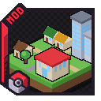
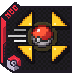

---
hide:
  - navigation
  - toc
---

# Cobblemon mods by shiero

Mods that turn a Cobblemon world into an adventure: roads and towns worth exploring, a Nuzlocke
that enforces itself, every HM in your own hands, and more. The documentation for all of them lives
here.

[Browse the mods](#the-mods){ .md-button }
[Report a bug](#found-a-bug-or-have-an-idea){ .md-button }
[Discord](https://discord.gg/SwcwXcCN4k){ .md-button }

## The mods

<button type="button" data-filter="" aria-pressed="true">All</button>
<button type="button" data-filter="client-only" aria-pressed="false">Client-only</button>
<button type="button" data-filter="no-cobblemon" aria-pressed="false">No Cobblemon</button>

" markdown>
{ .mod-row__logo }

[Routes](routes/index.md){ .mod-row__name }
Roads between your structures, named routes and map integration.
<!-- mod-chips:routes -->

" markdown>
{ .mod-row__logo }

[Cobblemon Nuzlocke & Soul Link](nuzlocke/index.md){ .mod-row__name }
A Hardcore Nuzlocke the game enforces, plus co-op Soul Link.
<!-- mod-chips:nuzlocke -->

" markdown>
{ .mod-row__logo }

[Cobblemon Picnic](picnic/index.md){ .mod-row__name }
A picnic table that re-rolls the wild spawns around it.
<!-- mod-chips:picnic -->

" markdown>
{ .mod-row__logo }

[Cobblemon HMs](ditto-hms/index.md){ .mod-row__name }
Your Pokémon lend you their moves: HMs on your fist, auras on you.
<!-- mod-chips:ditto-hms -->

" markdown>
{ .mod-row__logo }

[Cobblemon Raid Icons](raid-icons/index.md){ .mod-row__name }
Every raid den on your minimap and world map.
<!-- mod-chips:raid-icons -->

" markdown>
{ .mod-row__logo }

[Cobblemon Champions Training](champions/index.md){ .mod-row__name }
Stat points instead of EVs, spent from the summary.
<!-- mod-chips:champions -->

" markdown>
{ .mod-row__logo }

[Cobblemon Mid-Battle EXP](mid-battle-exp/index.md){ .mod-row__name }
EXP at every knockout, used in the same battle.
<!-- mod-chips:mid-battle-exp -->

" markdown>
{ .mod-row__logo }

[Tree Carve](tree-carve/index.md){ .mod-row__name }
Carve messages and symbols into logs with a sword.
<!-- mod-chips:tree-carve -->

" markdown>
{ .mod-row__logo }

[Cobblemon PokeTowns](poketowns/index.md){ .mod-row__name }
Pokémon Centers, Marts and gyms in your villages.
<!-- mod-chips:poketowns -->

" markdown>
{ .mod-row__logo }

[Cobblemon Action Combat](action-combat/index.md){ .mod-row__name }
Cobblemon battles in real time: you drive your Pokémon.
<!-- mod-chips:action-combat -->

## Compatibility

Every mod runs on **Minecraft 1.21.1**, on **Fabric** and **NeoForge**; Tree Carve also has jars for
26.1 to 26.3. *Both* means the server and every player's game. Each mod's home page ends with the
full list for your loader.

<!-- mod-compat -->

## Start here

-   ### :material-download: Installing

    Every mod runs on **Minecraft 1.21.1** on either **Fabric** or **NeoForge**. Drop the jar for your
    loader into `mods/` — never both jars at once.

    Which Cobblemon each mod runs on, and what else it needs, is in the
    [compatibility table](#compatibility) above. Each mod's home page ends with the full list for
    your loader.

-   ### :material-tune: Configuring

    Routes and Nuzlocke are set up on the **world-creation screen** and stored with that world.
    Picnic, Ditto HMs and Raid Icons use in-game config: a command, or a settings screen. Tree Carve
    is set by operators with `/treecarve config`. Mid-Battle EXP has nothing to configure.

    See each mod's *Configuration* page.

-   ### :material-map-search: Finding things

    Every section follows the same order: **Getting Started**, the mod's own feature pages,
    **Commands**, **Configuration**, **Troubleshooting**, **Community Credits**.

    The search box at the top covers every mod at once.

## Found a bug, or have an idea?

Post in the mod's **tickets thread on [Discord](https://discord.gg/SwcwXcCN4k)** and tag it —
**Bug**, **Crash**, **Idea** or **Feedback**. A bot files it as an issue, replies in your thread
with what it needs from you, and posts back there when it is closed. **You do not need a GitHub
account.**

For a crash, attach `crash-reports/crash-*.txt` — the stack trace is what turns a hunt into a fix.

Something wrong on a page? Say so in the Discord — same place, same thread, and it gets fixed here.
