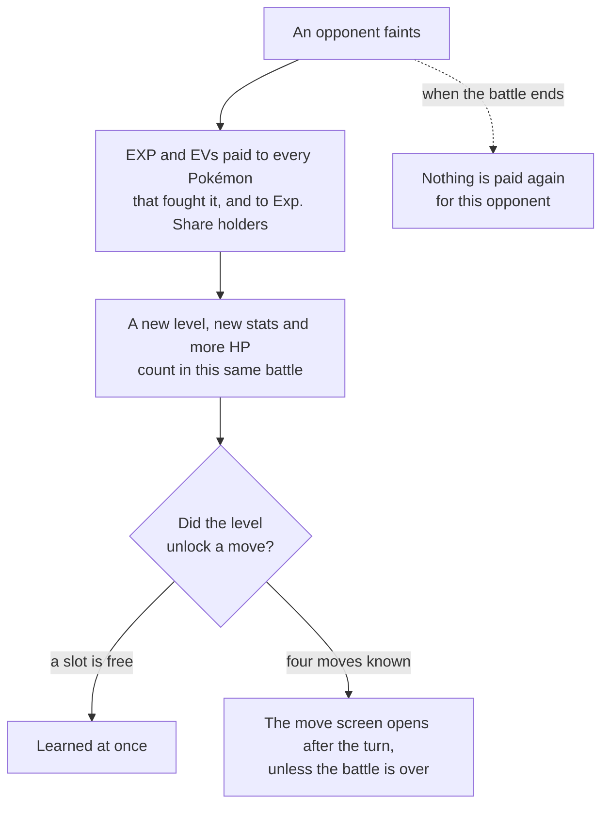
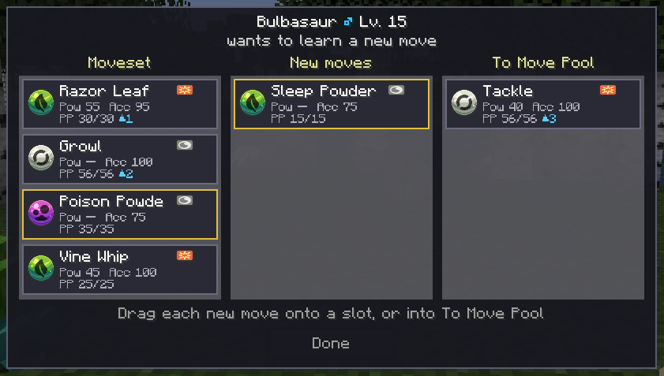

# How it works

Every rule the mod follows, from the knockout to the end of the battle.

## Experience and EVs at each knockout

When a Pokémon faints, the other side is paid **right then**:

- **Every Pokémon that fought it** gets the full amount. In a double battle, both of yours that faced
  it get the full amount each.
- **A Pokémon holding an Exp. Share** that did not fight it gets a share of that amount, Cobblemon's
  `experienceShareMultiplier`. It can be on the bench.
- Anyone else gets nothing.

The amount is **Cobblemon's own calculation**, so everything that changes it still does: a **Lucky
Egg**, a Pokémon from **another trainer**, one **ready to evolve**, **high friendship**, and
Cobblemon's `experienceMultiplier`. A mod that changes how much EXP a battle gives, or caps a level,
changes it here too.

**EVs** are paid at the same knockout, to the same Pokémon, the way the main series does it. Power
items and any mod that changes EV gains apply. The mod never names EVs; you see them only as stats
going up.

It works in every battle: wild Pokémon, trainers and other players.

### The end of the battle never pays twice

An opponent is **settled** at its knockout. When the battle ends, Cobblemon runs its usual payout,
and it pays **nothing** for an opponent a knockout already paid. You end the battle with what
Cobblemon would have given you, delivered knockout by knockout.

A knockout that happens after the battle is already over pays nothing at all.

### Who does not earn

- **A Pokémon that has fainted** gets nothing from later knockouts, unless Cobblemon's
  `awardExperienceToFaintedPokemon` is on. That setting exists only in Cobblemon 1.8; on 1.7, a
  fainted Pokémon never earns.
- **Against another player**, nothing is paid unless Cobblemon's `allowExperienceFromPvP` allows it.
- **Catching** a Pokémon pays no EXP, as in Cobblemon.

What a knockout paid is **yours to keep**, even if you go on to lose the battle.

## A new level counts in the same battle

A Pokémon that levels up at a knockout fights the rest of that battle at its new level.

- **Stats** are recalculated with the new level and EVs. EVs alone are enough: stats rise even
  without a new level.
- **Stat boosts** already set up stay, and multiply the new stats. +2 Attack is still +2.
- **HP** gains the difference in max HP. A Pokémon at 30/60 whose max HP rises to 64 has **34/64**,
  and the next hit is taken from 34.
- **A fainted Pokémon stays fainted.** A level or EVs never bring it back.
- **The bench** levels up too. An Exp. Share holder switches in with its new level and stats.
- **A transformed Pokémon** (Transform, Ditto) gets its new level and HP, and keeps the stats it
  copied until the transformation ends.
- **Evolution waits** for the battle to end, as it does in Cobblemon.

Everyone watching sees the new level and HP on the battle bar. The **switch screen** shows each
Pokémon's new level, HP and moves.

## The move screen

A level-up can unlock a move. What happens next depends on whether the Pokémon has room for it.

**With a free slot**, the move is learned at once, with full PP, and you can use it on the next turn.
No screen opens.

**With four moves**, the move screen opens once the turn has played out.

The header names the Pokémon: `Sparky (Pikachu) ♂ Lv. 8`, or `Pikachu ♂ Lv. 8` without a nickname.
The cards are in two columns:

| Column | What it holds |
|---|---|
| **Moveset** | the four moves the Pokémon knows, in their slots |
| **Move Pool** | every move this level-up unlocked, with a gold outline, and every move a new one replaced |

**Drag a move from Move Pool onto a moveset slot** to learn it. The move it replaces drops into
**Move Pool**. Everything is reversible until you press **Done**: a replaced move can go back into its
own slot, and the moveset never loses a slot.

- **Done** is always available. Whatever is still in **Move Pool** goes to the move pool, new moves
  included, so pressing Done straight away learns nothing.
- **Esc does not close it.** The send-out key (**R** by default) minimises it along with the battle,
  and it comes back exactly as you left it.
- Each card is Cobblemon's own move card: the move's type and category, then icons for its power,
  accuracy (`—` for a move that cannot miss) and effect chance, and its PP. A `▲N` badge counts its
  PP Ups. Hover a card for the move's description, or the badge for what a PP Up is.
- **A forgotten move goes to the move pool and keeps its PP Ups**, so learning it back later costs
  nothing.
- **A new move enters with full PP.** If it was already in the move pool, it brings that entry's PP
  Ups and leaves the pool.
- **Several Pokémon, several screens:** one per Pokémon, in party order. The next opens when you
  press Done on the one before. Two moves unlocked at once share one screen.
- **The knockout that ends the battle opens nothing.** Its new moves wait in the move pool, where you
  can teach them from the summary as always.
- If the battle ends some other way while the screen is open (forfeit, disconnect), the screen
  closes, nothing is learned and the new moves stay in the move pool.

## Battle log

Everything the mod changes is written into the battle log, **only for the Pokémon's owner**. Your
opponent and anyone watching see the new level and HP on the battle bar, and nothing else.

| When | The line |
|---|---|
| A knockout pays EXP | `Pikachu gained 245 Exp. Points!` |
| It levels up | `Pikachu grew to Lv. 23!` |
| Its stats change | `Pikachu's stats rose: HP +3, Atk +2, Spe +3` — only the stats that rose |
| It learns a move into a free slot | `Pikachu learned Thunderbolt!` |
| The move screen opens | `Pikachu wants to learn Thunderbolt…` — once per new move |
| A new move replaces an old one | `Pikachu forgot Tackle and learned Thunderbolt!` |
| A new move goes to the move pool | `Pikachu did not learn Thunderbolt.` |

A nickname is used wherever the Pokémon has one. A Pokémon at level 100 gains no EXP, so it gets no
EXP or level line, only `stats rose` when its EVs move a stat.

## Supported versions

| | |
|---|---|
| **Minecraft** | 1.21.1 |
| **Loaders** | Fabric and NeoForge |
| **Cobblemon** | 1.7 and 1.8, with the same jar |
| **Requires** | Architectury API, and Fabric Language Kotlin (Fabric) or Kotlin for Forge (NeoForge) |
