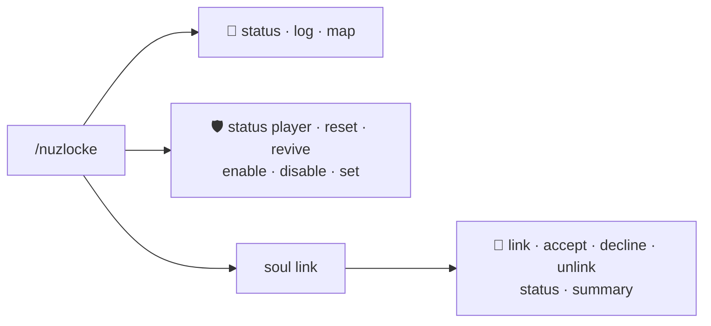
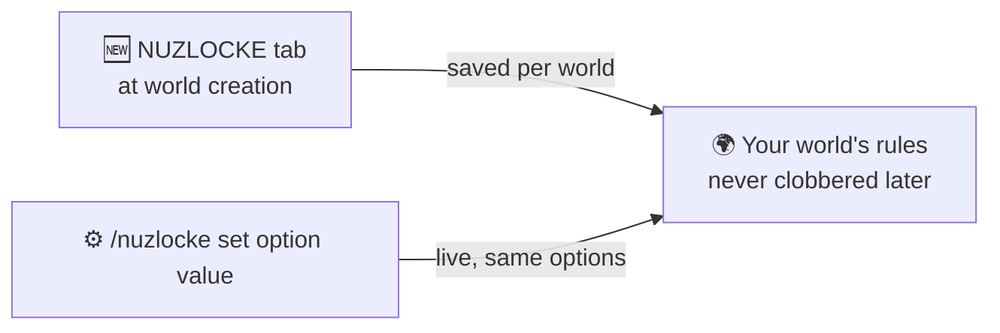

# ⌨️ Commands & Config

Everything under the **`/nuzlocke`** root, and every switch the ruleset has. Routes' road commands
live under [`/routes`](../routes/commands.md) — the two never mix.

👤 = every player · 🛡️ = operator (permission level 2)

## Quick reference

| Command | Who | One-liner |
| --- | :---: | --- |
| `/nuzlocke status [player]` | 👤 / 🛡️ | Zone records + party deaths (`[player]` is op-only). |
| `/nuzlocke log` · key **I** | 👤 | The run's log — the Soul Link log while you are in a link. |
| `/nuzlocke map` | 👤 | Dump your capture zones as map waypoints. |
| `/nuzlocke reset [player]` | 🛡️ | Clear a player's zone records, lift their game-over and ask for a new Gym Leader Challenge type. They keep their team. |
| `/nuzlocke revive [player]` | 🛡️ | Revive a party's dead Pokémon. The mercy switch. |
| `/nuzlocke enable` · `disable` | 🛡️ | Master switch for this world, saved per world. |
| `/nuzlocke config list` | 👤 | Every setting for this world with its current value, by section. |
| `/nuzlocke config get <setting>` | 👤 | Read one setting back. |
| `/nuzlocke config set <setting> <value>` | 🛡️ | Change one, live. Offers the names and refuses a value out of range. |
| `/nuzlocke config reset <setting>` | 🛡️ | Put one back to its default. |
| `/nuzlocke config reload` | 🛡️ | Re-read `config/cobblemon_nuzlocke.json`, no restart needed. A world with its own settings keeps them. |
| `/nuzlocke config unoverride` | 🛡️ | Drop this world's own settings, so it follows the config files again. |
| `/nuzlocke set <option> <value>` | 🛡️ | The older spelling of `config set`, kept working. |
| `/nuzlocke debug exp` | 🛡️ | Log what the level cap decides for each EXP gain. |
| `/nuzlocke soullink …` | 👤 | The co-op suite — see [Soul Link](soul-link.md). |
| `/pokemonrestart` | 👤 | Wipe your own run and start over. Its own command, not a `/nuzlocke` one — it belongs to the player whose run it is. Type it twice to confirm. |

### `/nuzlocke soullink`

| Command | What it does |
| --- | --- |
| `link <player2> [player3] [player4]` | Offers a contract. Nothing binds until **everyone** accepts. |
| `accept` · `decline` | Answer an offer. The prompt also appears as a screen you cannot dismiss. |
| `unlink` | Dissolves **your** binds. |
| `status` | Lists your binds in chat, with ✝ marking the dead. |
| `summary` | The linked-teams screen: every member's full party, soulmates marked ⇄. |

Offering a link does not need the command — right-click a player and pick **Soul Link** from
Cobblemon's interaction wheel.

## Configuration

The ruleset is decided **when you create the world**, on a **NUZLOCKE** tab that sits next to
**GAME / WORLD / MORE**. Installing this add-on is what adds that tab; Routes' own generation options
live beside it on its [ROUTES tab](../routes/configuration.md).

Choices are stored **per world** and applied to new worlds only, so loading an existing world never
has its rules overwritten. Picking **Hardcore** at world creation turns the full ruleset on.

### The run

| Option | Default | Notes |
| --- | :---: | --- |
| Nuzlocke | on | master switch — off = a normal Cobblemon world |
| First-encounter lock | on | only the first wild per zone is catchable |
| Site encounters | on | structures grant one encounter per **kind** of site; off = none at all |
| Mandatory nicknames | on | the naming prompt |
| Whiteout | To Respawn Point | what losing a battle does — back to your respawn point, Game Over, or nothing |
| Healing sources | ALL | ALL / MACHINES_ONLY / ITEMS_ONLY / NONE |
| No bag in battle | on | closes the battle bag |
| Battle bag blocks | Everything | Everything, or **Healing only** — X items stay legal either way |
| Above level cap → PC | on | over-cap catches are boxed (the cap itself comes from RCT) |
| File the dead to the PC | on | a Pokémon that dies is moved out of your party. Your last one always stays |
| Capture zones are | Geography | what counts as one place — the world Routes draws, the **biome** underfoot, or **both** as a pair |
| Require nicknames | on | the naming prompt after every acquisition |
| No trading | on | trades are refused |
| No forfeit | on | battles cannot be surrendered |
| Revival Blessing | off | whether that move may revive mid-battle |
| Healers heal the trainer | on | a healing machine fills your health and hunger too |
| Healers set your respawn | on | the last healer you used is where you come back |
| Storm riding risk | 4% | chance per second that lightning finds you riding in the open, 0–100 |
| Mimic chests | 5% | share of roadside chests that are not chests, 0–100 |
| Dupes match · Dupes count | evolution line · ever caught | the two halves of the duplicates clause |
| Mega / Tera OK | on | under a Gym Leader Challenge, a Mega or Tera of your type still counts |
| Allow Mega · Gigantamax · Z-Moves · Tera | on | switch off any battle gimmick for a stricter run |
| Duplicates clause | evolution line | what counts as "already owned" |
| Egg clause | Encounter | the hatchling takes the zone it hatches in — or ban eggs, or exempt them |
| Defeated-catch window | 60 s | how long a beaten wild stays catchable — or off |
| Aggressive wilds | on | some species start a battle instead of meleeing you |
| Shared EXP | on | whole team gains EXP |
| EXP boost | x1 | x1 … x50, applies to the shared EXP too |
| PC only at the PC block | on | no remote PC access |

### Starters

| Option | Default | Notes |
| --- | :---: | --- |
| Starter selection | Mix | Normal / Random / Mix — Mix is a Grass, a Fire and a Water from three different generations, drawn from the real main-series starters |
| Starter level | 5 | 1–25 |
| No Legendaries · No Paradox · No Ultra Beasts | on | filters for the Random roll |
| No typical starters | off | excludes the pack's usual starters from Random |
| Shiny starter | Yes | No / Yes (normal odds) / Always |

### Gym Leader Challenge

| Option | Default | Notes |
| --- | :---: | --- |
| Gym Leader Challenge | on | offer every player a monotype run at character creation; off = never offered |

### Roads, towns and trainers

| Option | Default | Notes |
| --- | :---: | --- |
| Route trainers | on | needs a trainer mod; inert without one |
| Trainer entity ID | `rctmod:trainer` | which NPC to place |
| Trainer density | Medium | Low / Medium / High / Brutal — scales with route length |
| Trainer sight range | 15 | 0–64 blocks |
| Trainer field of view | 180° | the cone you must stand in to be challenged; 360 = they see behind them |
| One challenge gate | on | every challenge goes through this mod's guards; off = the trainer mod also challenges on its own, ignoring them |
| Always-aggressive trainers | `ltsurge` | ids that challenge on sight even though leaders normally wait |
| Challenge delay | 20 | ticks of "!" wind-up before the battle |
| Trainer skirmishes | on | trainers duel each other nearby |
| Trainers challenge on sight | on | off = they stay on the roads and never start a fight; you still battle them by right-clicking |
| Trainers holding post | 70% | share that stay put instead of wandering, 0–100 |
| Water crossing trainers | — | name fragments used to pick who stands on a water crossing |
| Fair-fight guard | on | a trainer too far above your strongest Pokémon never picks the fight |
| Max trainer level gap | 5 | how many levels above your strongest Pokémon a trainer may be and still challenge you, 0–50 |
| Gyms beside towns | on | needs a gym pack |
| Elite Four | on | one league building per world, beside a road; needs a league pack |
| Gyms on the surface | on | lifts a gym whose own definition would bury it |

### Route Pokémon

Every generated road carries encounter sources, disguised Cobblemon habitat blocks set into the
paving. Each one offers **one family of its own**: the evolution stage that fits its level, and, when
that stage is about to evolve, about one of the next stage for every three, five levels higher.

- **Most sources offer something native to where they stand**: the biome on land, the sea or river
  under a water crossing. A source on a bridge deck leans toward Flying types instead.
- **Each source keeps its own number of Pokémon out**, picked once from a range.
- **Now and then a source spawns an alpha**, which counts as the zone's encounter like any other.
- **Now and then a source spawns an aggressive Pokémon**, which comes after you on sight; its first
  hit starts a battle.
- **A route too short for the spacing still gets one source**, halfway along.

Needs Cobblemon 1.8.

| Option | Default | Notes |
| --- | :---: | --- |
| Route encounters | On | Off leaves roads with the ordinary spawns |
| Distance between sources | 128 | blocks of road from one source to the next, 32–512 |
| Source looks like | *(empty)* | empty: each source looks like the block it was set into; a block id (e.g. `minecraft:diamond_block`) makes every source that block |
| Fewest Pokémon out per source | 2 | the bottom of the range each source picks its number from, 1–64 |
| Most Pokémon out per source | 10 | the top of that range: how many of its own a source can have out at once |
| Source spawn chance per tick | 100% | 100 refills a source at once, 1 is about one Pokémon every five seconds |
| Wild spawns held back around a source | 16 | blocks around a source where only its own Pokémon appear; 0 = ordinary spawns there too |
| Typical source level | 32 | each source has its own five-level band, drawn from a bell curve centred here |
| Source level spread | 14 | how widely sources spread: most sit between 25 and 40, level 1–5 is rare and 75+ rarer still |
| Aggressive chance at a source | 10% | chance that a Pokémon a source spawns is aggressive; 0 = never |
| Sources native to their biome | 60% | share of sources that offer a Pokémon native to where they stand (Flying types on a bridge); 0 = any species |
| Alpha chance at a source | 2% | chance that a Pokémon a source spawns is an alpha; 0 = never |
| Allow Legendaries · Ultra Beasts · Paradox Pokémon | off | |
| Allow starters | off | every family in the starter picker stays off the roads |

[Soul Link](soul-link.md#settings) has its own settings.
