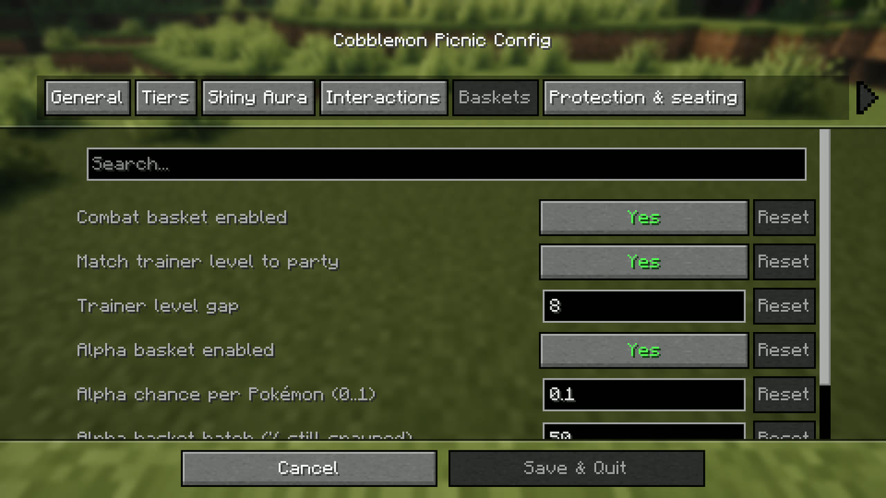

# Commands & Config

Everything lives under one command: **`/picnic`**.

```
/picnic                                           # print every setting (anyone)
/picnic config                                    # the same listing, for an operator
/picnic config <feature>                          # one feature's settings (operator)
/picnic config <feature> <setting> <value>        # change one (operator)
/picnic config <feature> <setting> default        # put it back to its default (operator)
/picnic config <feature> reset                    # put the whole feature back (operator)
/picnic stats                                     # picnic statistics (anyone)
/picnic stats player|dimension|species <value>    # one slice of them (anyone)
/picnic stats shiny                               # just the shinies (anyone)
/picnic stats reset                               # clear the aggregates (operator)
/picnic reload                                    # re-read the config file from disk (operator)
/picnic reset                                     # restore every default (operator)
```

`default` works on **every** setting — you never have to look up what the shipped value was.

## `/picnic config` — the settings

Reading them is open to **everyone** through `/picnic`: knowing the shiny-aura multiplier and the
re-roll cooldown you're playing under is part of playing. Changing anything needs **operator** rank.

Every feature has an `enabled` switch, so a server can keep the picnic and drop any part of it.

```
/picnic config shinyaura multiplier 3             # a full table triples shiny odds
/picnic config shinyaura multiplier default       # back to ×2
/picnic config reroll enabled false               # switch the spawn re-roll off entirely
/picnic config reroll spawncap expert 16          # per-tier settings take the tier in the middle
/picnic config reroll protectshiny expert true    # per-rung settings take the rung
/picnic config wash reset                         # every washing setting back to its default
```

Tiers and rungs are both `basic`, `advanced` and `expert`. A Diving, Hot or Strange table still
standing from before 5.0.0 uses the `expert` values.

### Features and their settings

| Feature | Setting | Value | What it does |
|---------|---------|-------|--------------|
| `reroll` | `enabled` | true/false | The [spawn re-roll](spawn-rerolling.md) itself. *Default on.* |
| | `cooldown` | 0–3600 | Seconds between re-rolls, per table **and** per player. *Default 5. 0 disables.* |
| | `spawncap <tier>` | int | Max Pokémon per re-roll for that tier. |
| | `fuelcost <tier>` | int | Bread per re-roll for that tier (7 Basic, 5 Advanced, 3 above). `0` makes it free. |
| | `radius <tier>` | blocks | How far that tier's re-roll reaches, both the area it clears and the area it fills. *Default 32 Basic, 48 Advanced, 64 above.* |
| | `clearance` | 0–16 | Blocks around **you** where nothing spawns, so a group never lands on top of you. *Default 2.* Picnic blocks are always off-limits. |
| | `flyinglift` | 0–64 | How high re-rolled fliers are lifted off the ground (default `12`, `0` grounds them). Never changes *which* Pokémon spawn. |
| | `flierleash` | 0–600 | Seconds a re-rolled flier is kept within the table's re-roll radius (default `30`, `0` lets it roam at once). |
| | `log` | true/false | Writes every re-roll to `latest.log`: what it cleared and spawned, one line per Pokémon. *Default on.* |
| | `protectshiny <rung>` | true/false | The re-roll keeps **shiny** wild Pokémon instead of despawning them. *Default off.* |
| | `protectlegendary <rung>` | true/false | Keeps **legendary** wild Pokémon. *Default off.* |
| | `protectmythical <rung>` | true/false | Keeps **mythical** wild Pokémon. *Default off.* |
| | `protectultrabeast <rung>` | true/false | Keeps **Ultra Beast** wild Pokémon. *Default off.* |
| | `protectalpha <rung>` | true/false | Keeps **alpha** wild Pokémon. *Default off.* |
| `platforms` | `enabled` | true/false | A re-roll may spawn on [any floor you built](spawn-rerolling.md#built-platforms) (planks, quartz, concrete…), not only natural ground. *Default off.* |
| `snackbias` | `enabled` | true/false | A re-roll borrows the spawn influences of a nearby seasoned poke-snack. *Default off.* |
| `tmteach` | `enabled` | true/false | [Party move teaching](spawn-rerolling.md#party-move-teaching) on a re-roll. *Default on.* |
| | `chance` | 0..1 | Chance per re-roll. *Default 0.05.* |
| | `tm` | true/false | TM moves may be taught. *Default on.* |
| | `tutor` | true/false | Tutor moves may be taught. *Default on.* |
| | `egg` | true/false | Egg moves may be taught. *Default on.* |
| `alphaboost` | `enabled` | true/false | The [Alpha Basket](picnic-tables.md#the-special-baskets). Off: a table with one re-rolls normally. *Default on.* |
| | `chance` | 0..1 | Chance each Pokémon of an Alpha Basket re-roll is an alpha. *Default 0.10.* |
| | `batch` | 1–100 | Percent of the batch an Alpha Basket re-roll still spawns. *Default 50.* |
| `shinyaura` | `enabled` | true/false | The [Shiny Aura](shiny-aura.md). *Default on.* |
| | `multiplier` | 1–100 | How many times better your shiny odds get at a **full table**. *Default 2 (double).* |
| `deploy` | `enabled` | true/false | Sitting down sends out your party. *Default on.* |
| | `mindistance` | 0–32 | Closest a party member lands, in blocks. *Default 4.* |
| | `maxdistance` | 0–32 | Furthest a party member lands. *Default 7.* Each Pokémon rolls its own distance in the band, and a max below the min is raised to it. |
| `peaceful` | `enabled` | true/false | While someone is seated, hostile mobs **flee** the table. *Default on.* |
| | `radius` | 0–128 | How far that reaches, in blocks. *Default 30.* |
| `wash` | `enabled` | true/false | [Washing](interactions-and-items.md), from the wheel or with a Poke-sponge. *Default on.* |
| | `friendship` | int | Friendship gained from a wash. |
| | `cooldown` | seconds | Wait between washes, **per Pokémon**. *Default 3.* |
| | `requirestable` | true/false | Need a nearby table to wash. Off also shows the option on the wheel everywhere. |
| | `blockinbattle` | true/false | Washing is [refused during a battle](interactions-and-items.md#not-during-a-battle) (a Cobblemon battle or an Action Combat fight). *Default on.* |
| `play` | `enabled` | true/false | [Playing fetch](interactions-and-items.md), from the wheel or with a thrown Fetchball. *Default on.* |
| | `friendship` | int | Friendship gained from a game. |
| | `breakchance` | 0..1 | Chance a slime ball splatters. A [Fetchball](interactions-and-items.md#fetchball) ignores this. |
| | `cooldown` | seconds | Wait between games, **per Pokémon**. *Default 3.* |
| | `requirestable` | true/false | Need a nearby table to play. Off also shows the option on the wheel everywhere. |
| | `blockinbattle` | true/false | Playing and the Fetchball are [refused during a battle](interactions-and-items.md#not-during-a-battle). *Default on.* |
| `battleseeker` | `enabled` | true/false | The [Combat Basket](interactions-and-items.md#combat-basket) (it kept the name of the Battle Seeker it replaced). Off: a table with one summons no trainer. *Default on.* |
| | `blockinbattle` | true/false | The Combat Basket re-roll is [refused while you are already in a battle](interactions-and-items.md#combat-basket). *Default on.* |
| | `matchlevel` | true/false | Scale summoned trainers to your party's level. *Default on.* |
| | `levelgap` | int | Level offset for summoned trainers. *Default 8.* |
| `hazards` | `enabled` | true/false | What a table and its basket carry between dimensions — [burning, scorching, flooding and drifting](picnic-tables.md#where-each-table-can-go). Off, every table is plain furniture. *Default on.* |
| `reigrouping` | `enabled` | true/false | With REI installed, folds each table wood, the coloured baskets and the benches into one expandable REI entry. Client-side: it groups your own game's REI list, applied on REI's next reload (F3+T). *Default on.* |
| `table` | `light` | 0–15 | Light level emitted by the table. Re-place a table to relight it. |
| | `actiondistance` | 0–512 | How close a table has to be for the table-gated actions. *Default 25.* |

The five `protect…` settings are **opt-in** and granular: turn on only the rarities you want the
re-roll to spare, on only the rungs you want. `peaceful` is **on by default**: sit at a table and
hostile mobs within `radius` blocks lose their target and run away, like a creeper fleeing a cat.

## `/picnic stats`

Available to **everyone**. Shows a summary of picnic activity:

- Total re-rolls, Pokémon spawned / despawned
- **Shinies** found (with ratio), **legendaries / mythicals**, **alphas**
- Snacks consumed, distinct species
- **Most common** and **rarest** species

```
/picnic stats          # show the summary
/picnic stats reset    # (operator) clear the aggregates
```

### Filters

Ask for one slice instead of the lot. Each filter reports its own re-roll count, what came out, and
the shiny rate for that slice alone — and for shinies, the species, level and coordinates of each one.
All of them are open to everyone.

```
/picnic stats player <name>       # everything one trainer's re-rolls produced
/picnic stats dimension <id>      # e.g. minecraft:the_nether
/picnic stats species <name>      # every appearance of one species
/picnic stats shiny               # just the shinies, and where they turned up
```

`species` tab-completes from what the log has actually seen. `player` and `dimension` are free text,
so you can ask about someone who's offline or a dimension that isn't loaded right now.

Statistics persist in `config/cobblemon_picnic_stats.json` (aggregates) and
`config/cobblemon_picnic_events.jsonl` (a granular per-re-roll log). The **summary** reads the
aggregates; the **filters** replay the log, which is the only place the per-re-roll detail survives —
so a filter can look back further than the last `stats reset`.

## The settings screen

With **[Cloth Config](https://modrinth.com/mod/cloth-config)** installed, the same values are editable
in a GUI — on Fabric via **[Mod Menu](https://modrinth.com/mod/modmenu) → Cobblemon Picnic → Settings**,
on NeoForge via the **Config** button in the mods list. Its pages:

| Page | What's on it |
|---|---|
| **General** | Re-roll switch and cooldown, light level, party deploy and its distances, flier lift and leash, spawn clearance, re-roll log, action distance |
| **Tiers** | Spawn cap, fuel cost and **re-roll radius** for Basic, Advanced and Expert |
| **Shiny Aura** | The aura switch and the full-table multiplier, with the ladder it works out to |
| **Interactions** | Washing, playing fetch (each with its "blocked in battle" switch), and party move teaching (chance, and TM / tutor / egg moves) |
| **Baskets** | The Combat Basket (switch, blocked in battle, level match, level gap), the Alpha Basket (switch, chance, batch), the dimension hazards and REI colour grouping |
| **Protection & seating** | What a re-roll keeps (shiny, legendary, mythical, Ultra Beast, alpha) per rung, snack bias, built platforms, and mobs fleeing a seated table |



⚠️ On a **server** that screen only edits **your own** game's file, and says so at the top. Use
`/picnic config` to change the settings everyone plays under.

## The config file

```
config/cobblemon_picnic.json          # settings
config/cobblemon_picnic_stats.json    # statistics aggregates
config/cobblemon_picnic_events.jsonl  # granular per-re-roll log
```

Edit the first by hand if you like, then apply it with `/picnic reload` — no restart needed. If the
file can't be read, `/picnic reload` says why and changes nothing, and the mod leaves the file alone
until it is fixed: settings changed in the meantime last until the server stops.

## Defaults

| Tier | Spawn cap | Fuel/re-roll | Radius | Seats |
|------|:---------:|:------------:|:------:|:-----:|
| Basic | 5 | 7 | 32 | 2 |
| Advanced | 8 | 5 | 48 | 3 |
| Expert | 12 | 3 | 64 | 4 |

Seat counts are **fixed per tier** and not configurable. Elsewhere: re-roll cooldown **5 s**
(per-table *and* per-player), party TM cross-teach **5%**, full-table shiny multiplier **×2**, wash
and play cooldowns **3 s** each (per Pokémon), party deploy **4–7 blocks**, Alpha Basket **10%**
alphas at **50%** of the batch.

### Picnic without the spawn manipulation

`/picnic config reroll enabled false` switches the re-roll off entirely — right-clicking a table then
spawns and
despawns nothing, and costs no bread. Seats, the [Shiny Aura](shiny-aura.md), bread baskets and the
[care interactions](interactions-and-items.md) all keep working.
