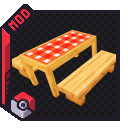

{ .hero-logo }

# Cobblemon Picnic

Spawn-hunting, made cozy. Place a **Picnic Table**, left-click it, and the wild Pokémon around you
are despawned and re-rolled into a fresh maximised spawn — hunt a shiny or a specific species
without walking the map raw. It doubles as a social station: shiny aura, Pokémon care and trainer
battles.

<!-- mod-badges -->

[Get started](getting-started.md){ .md-button }
[Picnic tables](picnic-tables.md){ .md-button }

## What can it do?

- :material-dice-multiple: **[Spawn re-rolling](spawn-rerolling.md)** — clear the wild Pokémon around
  you and roll a fresh batch, on demand.
- :material-table-chair: **[Three table tiers](picnic-tables.md)** — Basic, Advanced and Expert,
  each bigger and cheaper to re-roll than the last.
- :material-basket: **[Special baskets](picnic-tables.md#baskets)** — put one in an Expert table to
  picnic underwater, in the Nether or the End, hunt alphas, or summon trainers.
- :material-star-four-points: **[Shiny aura](shiny-aura.md)** — sit together and everyone's shiny
  odds go up. A full table doubles them.
- :material-paw: **[Items & care](interactions-and-items.md)** — wash and play with your Pokémon,
  and store bread in baskets.
- :material-lifebuoy: **[Troubleshooting](troubleshooting.md)** — a re-roll that spawned nothing,
  fliers that vanish, and what the game's messages mean.
- :material-console: **[Commands & config](commands.md)** — tune every number in game, and read the
  statistics of every re-roll you've ever made.

## Get it

<!-- mod-spec -->

New here? Start with **[Getting Started](getting-started.md)**.
