# Picnic Tables

Picnic Tables are the core block of the mod. Each is a **3×2 multiblock**: the **center column**
holds the **table cells** (re-roll + GUI), and the **side cells** are **benches** you can sit on, up
to the tier's seat cap. Leftover side cells stay empty.

## Tiers

| Tier | Spawn cap | Radius | Seats | Fuel / re-roll | Basket slot |
|------|:---------:|:------:|:-----:|:--------------:|-------------|
| **Basic** | 5 | 32 | 2 | 7 bread | Locked: keeps the basket it was crafted with |
| **Advanced** | 8 | 48 | 3 | 5 bread | Locked: keeps the basket it was crafted with |
| **Expert** | 12 | 64 | 4 | 3 bread | **Swappable**: takes every [special basket](#baskets) |

- **Spawn cap** — the maximum Pokémon a single re-roll can spawn (and the GUI slider's max).
- **Radius** — how far around the table wild Pokémon are despawned and re-rolled.
- **Seats** — how many benches the footprint provides (seat counts are **fixed per tier**, not
  configurable).
- **Fuel** — bread consumed per re-roll, cheaper as tiers improve (7 for Basic, 5 for Advanced, 3 for
  Expert). Bread comes from the table's fuel slot or from a nearby
  **[Picnic Basket](interactions-and-items.md#picnic-baskets)**. The per-tier cost is configurable
  (`/picnic config reroll fuelcost <tier>`).

**Basic → Advanced → Expert** is the whole ladder. What used to be the Diving, Hot and Strange tables
are now **baskets** you put in an Expert table: see [Baskets](#baskets).

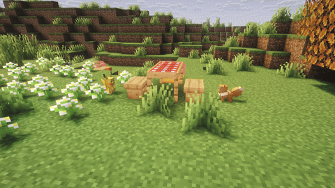

## Crafting

A Picnic Table is built in two steps: craft the **three components**, then assemble them into the
**Basic Picnic Table**. Higher tiers are upgrades of that one.

### 1. The components

Each one comes in every color or wood the table can be built from — the grids below show one
example.

=== "Table"

    The tabletop. Any of the **16 dye colors** of wool over any of the **11 woods** of planks — the
    wool is the cloth and the planks are the frame, so there are **176** of them (*Red Table*,
    *Spruce Red Table*, *Cherry Black Table*, …). Oak's are the ones with no wood in the name.

    

    

      

        

        

        

        

        

        

        

      

      
➜

      

    

    

    | Ingredient | Amount |
    | --- | :---: |
    |  Wool — any of the 16 colors | 3 |
    | 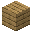 Planks — any of the 11 woods | 2 |
    | **→ 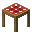 Table** in that color and wood | **1** |

=== "Dining Bench"

    The seat. Slabs and planks of the **same wood** — available in **11 woods**: oak, spruce, birch,
    jungle, acacia, dark oak, mangrove, cherry, bamboo, crimson and warped.

    

    

      

        

        

        

        

        

        

        

      

      
➜

      
2

    

    

    | Ingredient | Amount |
    | --- | :---: |
    | 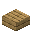 Slab — any of the 11 woods | 3 |
    |  Planks of the same wood | 2 |
    | **→ 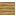 Dining Bench** in that wood | **2** |

=== "Picnic Basket"

    Apricorns over apricorn planks, in a 2×2 corner of the grid. One per apricorn color — white,
    black, blue, green, pink, red and yellow.

    

    

      

        

        

        

        
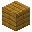

        

        

        

      

      
➜

      

    

    

    | Ingredient | Amount |
    | --- | :---: |
    |  Apricorn — any of the 7 colors | 2 |
    |  Apricorn Planks | 2 |
    | **→  Picnic Basket** in that color | **1** |

    A basket is also useful on its own, as a
    **[bread store](interactions-and-items.md#picnic-baskets)** next to the table.

### 2. The Basic Picnic Table

  

    

    

    

    

    

    

    

    

    

  

  
➜

  

| Ingredient | Amount | Accepts |
| --- | :---: | --- |
|  Picnic Basket | 1 | any of the 7 colors |
|  Vivichoke | 1 | — |
|  Table | 2 | any of the 176 — **the left one sets the cloth colour and the frame wood**. Tables from **CobbleFurnies** and **Handcrafted** work too |
|  Campfire Pot | 1 | any Cobblemon Campfire Pot, or Cobblemon's own Campfire |
|  Dining Bench | 2 | any of the 11 woods — **each one becomes a seat, in the order you place them**. Benches from **Handcrafted** work too |
|  Campfire | 1 | Campfire *or*  Soul Campfire |
| **→  Basic Picnic Table** | **1** | |

The result is drawn as **exactly the items you built it from**: the cloth and the wood of the table
you used, and **a separate bench per seat** — two benches of different woods come out as two
different seats. All of it with the mod's **own models and textures**, so no other furniture mod is
required. The basket you crafted it with starts in the table's [basket slot](#baskets) and stands
beside the table in its colour; the pot and campfire are consumed but don't change how the table looks.

Hold **Shift** over a picnic table in your inventory to read back everything it is made of.

### 3. Upgrading

The three higher tiers are **shapeless** — the ingredients can sit anywhere in the grid. An upgrade
**keeps the colour and the woods** the table was crafted with, and it adds a seat: **the bench you
hand over is the bench that seat is made of**. A table can end up with four seats in four woods.

=== "Advanced"

    

    

      

        

        

        

        

        

      

      
➜

      
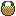

    

    

    | Ingredient | Amount |
    | --- | :---: |
    |  Basic Picnic Table | 1 |
    |  Diamond | 1 |
    |  Dining Bench — any wood | 1 |
    | **→  Advanced Picnic Table** | **1** |

=== "Expert"

    

    

      

        

        
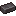

        

        

        

      

      
➜

      

    

    

    | Ingredient | Amount |
    | --- | :---: |
    |  Advanced Picnic Table | 1 |
    |  Netherite Ingot | 1 |
    |  Dining Bench — any wood | 1 |
    | **→  Expert Picnic Table** | **1** |

## Dyeing

A table that is already placed can be **recoloured without picking it up**. Hold a dye and
**sneak + right-click**:

- **The top of a table** repaints its cloth, in any of the **16 dye colours**. A picnic table is
  **two tables side by side**, and only the one you clicked changes — the two can wear different
  colours.
- **The table's basket** repaints the basket, in any of the **7 basket colours**: white, black,
  blue, green, pink, red and yellow. A special basket keeps its emblem. Any other dye does nothing to it.

**The wood never takes a dye.** The benches and the frame keep the woods the table was crafted
with, and clicking them with a dye does nothing.

Each repaint uses up **one dye**, and none is spent on something that is already that colour.
Sneaking is what makes it a dye: without it, the click does what it always does.

A loose [Picnic Basket](interactions-and-items.md#picnic-baskets) can be dyed the same way.

## Baskets

Every table has a **basket slot** next to the bread in its screen, and a new table starts with the
basket it was crafted with. What sits in that slot decides what the table does.

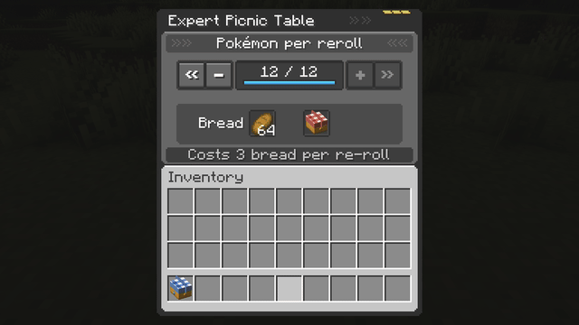

- **On an Expert table the basket swaps.** Click a basket onto the slot and the old one comes back to
  you. A basket never comes out on its own, only swapped for another one.
- **On Basic and Advanced tables the basket is locked** — a padlock on the slot. It stays the plain
  basket the table was crafted with, so the special baskets are an Expert table's business.

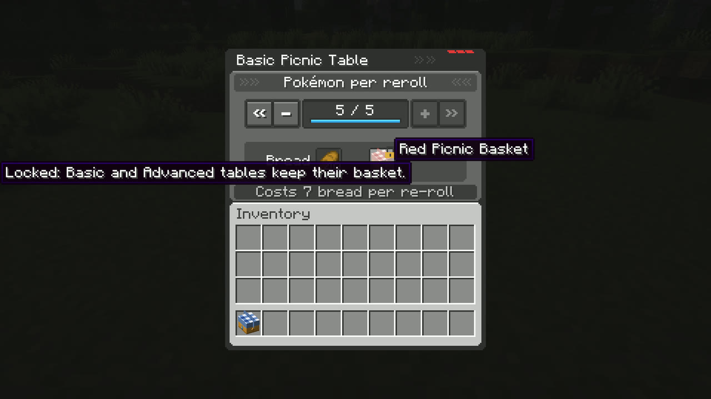

### The special baskets

Each one is **any Picnic Basket plus one ingredient**, shapeless. It keeps the basket's **apricorn
colour** and gets an emblem on the front; the basket drawn on the table is the one in the slot,
colour and emblem, and it gives off a few particles of its kind.

| Basket | Recipe | In an Expert table |
|---|---|---|
| **Water Basket** 💧 | basket + heart of the sea | The table is [at home underwater](#where-each-table-can-go) |
| **Fire Basket** 🔥 | basket + fire charge | The table is [at home in the Nether](#where-each-table-can-go) |
| **Strange Basket** 👁️ | basket + eye of ender | The table is [at home in the End](#where-each-table-can-go) |
| **Alpha Basket** | basket + ghast tear | Every Pokémon a re-roll spawns has a **10%** chance to be an **alpha**, but only **half** the batch spawns (rounded up) |
| **Combat Basket** ⚔️ | basket + iron sword | Every re-roll also summons an **RCT trainer** to battle — see [Combat Basket](interactions-and-items.md#combat-basket) |

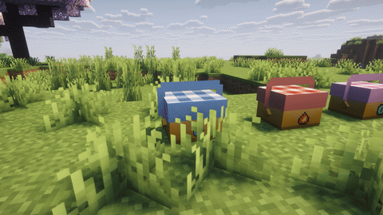

**Alpha Basket.** The table screen shows the smaller batch in gold, and alphas turn up in the re-roll
log and in `/picnic stats`. Each one is a **full alpha**, the same as one from a Hopo Berry
seasoning: it gets its alpha moveset, matches its level to nearby players like a natural alpha and
shows as alpha right away. The Alpha Basket only fits an **Expert** table. An operator changes the chance and the batch with
[`/picnic config alphaboost`](commands.md#features-and-their-settings).

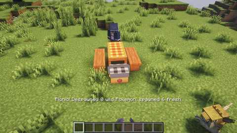

**Alpha and Combat baskets are for Overworld picnics.** They carry no home of their own, so their
table is a plain Expert table: it [burns in the Nether and drifts in the End](#where-each-table-can-go).
A table holds one basket, so alpha hunting and RCT trainers only work in the Overworld. The baskets'
tooltip says so too.

Placed on its own, a special basket keeps its emblem and drops back as the same basket. It still
stores bread like any [Picnic Basket](interactions-and-items.md#picnic-baskets).

## Where each table can go

**Any table can be placed in any dimension.** Where a table goes is your business — what the place
does to it once it is standing there is the dimension's.

A **Water, Fire or Strange basket** makes an Expert table belong somewhere, and **carry that somewhere
with it**. At home it is simply a table. Anywhere else it inflicts on its surroundings exactly what an
ordinary table suffers where that home is native: fire scorches, strange will not sit still, water
floods.

| Table | Overworld | Nether | The End |
|---|:---:|:---:|:---:|
| **Any table without a dimension basket** | ✅ | ⚠️ catches fire | ⚠️ drifts away |
| **Expert + Water Basket** | 🌊 floods on each re-roll (on dry land) | 🔥 **burns at once** | 🌊 floods · ⚠️ drifts away |
| **Expert + Fire Basket** | 🔥 scorches on each re-roll | ✅ **at home** | 🔥 scorches · ⚠️ drifts away |
| **Expert + Strange Basket** | ⚠️ drifts away | ⚠️ drifts · catches fire | ✅ **at home** |

🔥 **An ordinary table burns in the Nether.** Leave any table without a Fire basket down there and it
has a **30% chance every second** of a flame taking hold on it. Nothing is destroyed outright — it
burns from there under the normal fire rules, so you can still put it out. A **Water basket** is the
exception in the other direction: a tableful of water in that heat goes up **the moment it arrives**.
To picnic in the Nether properly, bring a Fire basket: nothing sets that table alight, anywhere.

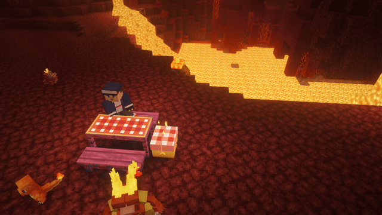

🌡️ **The Fire basket takes the Nether with it.** Anywhere else, **each re-roll** scorches the ground
around the table: its heat reaches **6 blocks** out, lights many blocks at once and sets every
creature in reach on fire for **8 seconds** — **including whoever is sitting at it**. It is a basket
for the Nether, and taking it home is supposed to be a bad idea.

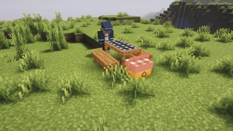

🌊 **The Water basket takes the water with it.** Out of the water, **each re-roll** flushes the ring of
blocks around the table with **flowing water** (never the table itself). Nothing feeds it, so it
drains on its own and leaves the floor clean. Underwater it just sits there, because there is nothing
left to spill. **Expert tables can be placed in water**, so you can set one on the sea floor and put
the Water basket in afterwards; Basic and Advanced tables still refuse water.

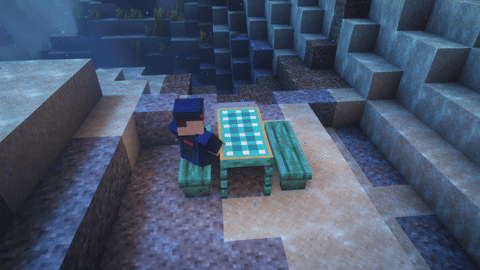

🌌 **The End will not hold a picnic still, and the Strange basket will not sit still anywhere else.**
Sit down at any table without a Strange basket out there, or try to re-roll at it, and the whole
table is **somewhere else within 24 blocks** before the click lands — leaving you standing where it
used to be. Nothing is lost: the bread and the basket, the cloth colour and the woods it was crafted
with, and your Pokémon-per-re-roll setting all travel with it. A table with nowhere to go — walled
in, or ringed by void — stays put and works normally. To picnic in the End properly, bring a Strange
basket: that table never drifts.

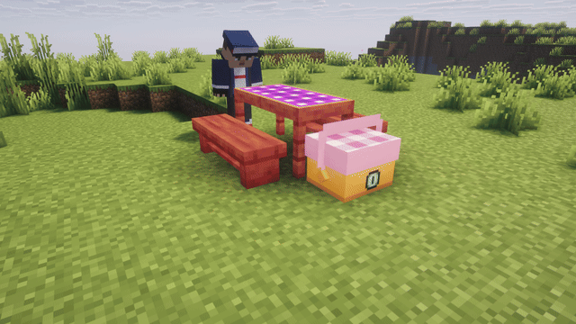

A server that wants none of this switches it all off with `/picnic config hazards enabled false`. Every
table is then plain furniture, wherever it stands.

### Diving, Hot and Strange tables from before 5.0.0

Those three tables can no longer be crafted and are gone from the creative tab. One already placed in
a world turns into an **Expert table with the matching Water, Fire or Strange basket** in its slot the
first time it loads, keeping its bread and its look. If it already held a basket of another kind,
that basket stays and the dimension basket drops beside the table.

Water, Fire and Strange baskets from before 5.0.0 (one colour each) turn into the coloured basket
with that emblem by themselves.

## Placement & orientation

The table **deploys in front of you**, with the **table column centred** on where you aim, oriented to
your facing — the "wide" axis runs left-to-right relative to you. The structure is one block tall:
benches on the sides, the functional table down the middle. All six cells must be free, and each table
needs its own footprint, since overlapping structures interfere with each other's cells.

**To pick it back up, break a bench.** Table cells take no mining damage — that's what keeps a re-roll
from destroying the table you're clicking. Breaking any bench takes the whole structure and returns
the table item.

**The basket stays inside it.** The table item that drops carries its basket, kind included, and
everything the table was built from, so placing it again brings both back. The bread in the slot
spills, and so does a leftover Battle Seeker. Tables from the creative tab come with a red basket.
