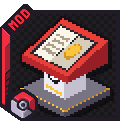

{ .hero-logo }

# Cobblemon PokeGyms

Gyms for Cobblemon multiplayer servers. PokeGyms finds the gym building of every Kanto city that
**Cobblemon Cities & Structures** generates, records it for the world, and stands a **Gym Manager**
inside its door: the one place where everything about that gym happens.

<!-- mod-badges -->

[Get started](getting-started.md){ .md-button }
[The Gym Manager](gyms.md){ .md-button }

!!! warning "Not released yet"
    PokeGyms has no public download yet. These pages describe the current development build,
    **0.0.41**. What it does today is find the gyms, give each City gym an RCT leader you can fight, after its RCT disciples of the leader's type, let you challenge the leader of a player-held gym
    (a loser pays its penalty into the gym's vault, a winner gets a signed medal, a Badge It badge if the gym has one, and a challenger waits before a rematch), scale every RCT trainer's team, leaders included, to your level (stage and moves too), let a leader invite up to three disciples who you fight in order before the leader, let the leader share the vault with them, let a player take a held gym over with its leader's medal, let a challenger call out the gym's next trainer from the Gym Manager, run their Gym Manager and tell other mods which battles are gym battles. Gym battle rules
    are not in the mod yet, and nothing here describes them.

## Highlights

- 🏙️ **[Every Cities & Structures gym, found](gyms.md#which-gyms)**: Pewter, Cerulean, Vermilion,
  Celadon, Fuchsia, Saffron, Cinnabar and Viridian, also in worlds generated before PokeGyms was
  installed.
- 📖 **[A Gym Manager in every gym](gyms.md#the-gym-manager)**: a lectern just inside the door that
  opens the gym's own screen, titled by its city, such as "Pewter City Gym".
- 🏛️ **[A Radical Cobblemon Trainers leader in every City gym](gyms.md#city-gyms-and-their-leaders)**:
  every gym starts as a City gym, led by one of RCT's own gym leaders.
- 🥊 **[Fight the City leader](gyms.md#fighting-a-city-leader)**: a stake of CobbleDollars, and it
  stays out of RCT's progression.
- 🧑‍🎓 **[City disciples](gyms.md#city-disciples)**: up to three RCT trainers of the leader's type,
  fought weakest first before the leader.
- 🔓 **[Beat the leader, unlock the gym](gyms.md#unlocking-a-city-gym)**: only a player who beats a
  City leader may buy that gym's licence.
- 🎫 **[Licences](licences.md)**: the rules for owning a gym are in place, one licence per player on
  the whole server.
- 💰 **[The gym vault](vault.md)**: a player leader sets a penalty, a challenger who loses pays it
  into the gym's vault, and the holder withdraws it.
- 🏆 **[Winner's share](vault.md#winners-share)**: beat a player leader and you take a share of its vault,
  10% by default.
- 🧑‍🏫 **[Disciples](gyms.md#disciples)**: a player leader invites up to three players, who register a team and stand at the
  gym as `Gym Trainer <player>`; challengers beat them in order before the leader.
- 🤝 **[Vault split](vault.md#splitting-the-vault)**: the leader gives each disciple a share of the vault, and a
  withdrawal pays everyone at once.
- 🔁 **[Take a gym over](gyms.md#taking-over-a-gym)**: hold the medal you won from a player leader and pay the fee,
  and the gym is yours, vault and disciples included.
- 🏅 **[Signed medals](gyms.md#medals)**: beat a player leader and you get a Gym Medal that names the gym,
  the leader and the date, or a signed Badge It badge when the leader registered one.
- 🎖️ **[Mainline badges](gyms.md#mainline-badges)**: with PKGBadges installed, beating a City leader gives the
  badge that leader gives in the main games.
- 📈 **[Level scaling](gyms.md#level-scaling)**: a leader's team, and every RCT trainer's, fights at the level of your best
  Pokémon, up or down, evolution stage included, so a battle is fair at any stage.
- ⚔️ **[Gym battles, recognised](gyms.md#gym-battles)**: a battle against a trainer inside a gym
  counts as a gym battle, so other mods can reward it, such as Mid-Battle EXP's extra EXP in gyms.
- ⚙️ **[Tuned in game](commands.md)** with `/pokegyms config`, no restart needed.

## Get it

<!-- mod-spec -->

No public download yet. New here? Start with **[Getting Started](getting-started.md)**.
