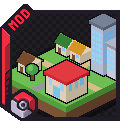

# Cobblemon PokeTowns

{ width="128" }

!!! warning "Discontinued"
    PokeTowns was never released and will not be. Its development has stopped, and this wiki no
    longer documents it.

For Pokémon Centers, Poké Marts, gyms and Kanto cities in your world, use
**[Cobblemon Cities & Structures](https://modrinth.com/mod/cobblemon-cities-structures)** instead.
It is the towns mod the pack uses now:

- [Routes](../routes/index.md) connects its cities to the road network.
- PokeGyms is being rebuilt on top of its gyms.
