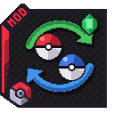

{ .hero-logo }

# Cobblemon PokeTrades

The in-game trade you remember. Someone out in the world will hand over a Pokémon you cannot catch
nearby, if you bring them the one they are asking for. The rarer the prize, the harder the ask.

<!-- mod-badges -->

[Get started](getting-started.md){ .md-button }
[How traders work](traders.md){ .md-button }

!!! warning "Not released yet"
    PokeTrades has no public download yet. These pages describe the current development build,
    **0.0.26**. Anything not described here is not in the mod yet.

## Highlights

- 🤝 **[Traders who are Cobblemon NPCs](traders.md#who-trades)**: talk to one and a trade screen
  shows every offer and which of your Pokémon fit.
- 💎 **[The rarer the prize, the harder the ask](traders.md#tiers)**: five tiers, from a plain swap
  to a legendary that wants perfect IVs or a shiny.
- 🎲 **[Each trader is its own](traders.md#offers)**: offers are drawn per trader and kept, and each
  player takes each offer once.
- 📛 **[A traded Pokémon is somebody else's](traders.md#the-pokemon-you-receive)**: original trainer
  kept, a fixed nickname, and trade evolutions on arrival.
- ❗ **[A marker over a trader's head](traders.md#the-marker)** tells you it still has something
  for you.
- 🏘️ **[Villages trade too](traders.md#village-traders)**: an unemployed villager next to a
  Cobblemon PC becomes a Pokémon Trader.
- 💰 **[More than Pokémon for Pokémon](traders.md#offer-types)**: trade for items, or for money with
  CobbleDollars.
- ⚔️ **[Beat a trainer, then trade with it](traders.md#rct-trainers)**: with Radical Cobblemon
  Trainers, what you give joins its team.

## Get it

<!-- mod-spec -->

No public download yet. New here? Start with **[Getting Started](getting-started.md)**.
