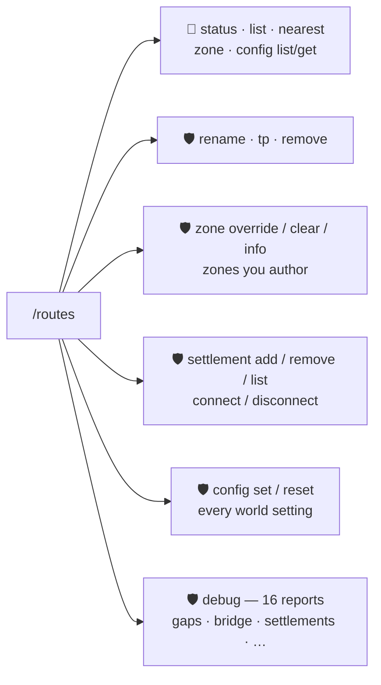

# ⌨️ Commands

The complete manual for every **`/routes`** command — the road network — and for **`/routesmap`**,
which changes how the map looks to you.

👤 = every player · 🛡️ = operator (permission level 2)

## Quick reference

| Command | Who | One-liner |
| --- | :---: | --- |
| `/routes status` | 👤 | How many towns, routes and areas have been discovered. |
| `/routes list [cities\|routes]` | 👤 | Every discovered town / route, with coordinates. |
| `/routes nearest` | 👤 | Closest discovered town and route, with distance and heading. |
| `/routes zone` | 👤 | What the chunk you stand in is painted as. |
| `/routes rename <name>` | 🛡️ | Rename the town you are standing in. |
| `/routes tp <town>` | 🛡️ | Teleport to a town somebody has visited. |
| `/routes remove` | 🛡️ | Remove the town or road you are standing on. |
| `/routes zone override <kind> [force]` | 🛡️ | Declare this chunk a different kind, and keep it that way. |
| `/routes zone clear [force]` | 🛡️ | Hand this chunk back to the generated map. |
| `/routes zone info` | 🛡️ | What the world generated here vs. what the override says. |
| `/routes zone create <kind> <from> <to> [name]` | 🛡️ | Author a whole box as a named zone. |
| `/routes zone expand\|reduce <name> <from> <to>` | 🛡️ | Grow or shrink it by a box. |
| `/routes zone delete\|rename <name> …` | 🛡️ | Remove it, or rename it. |
| `/routes zone list` | 🛡️ | Every authored zone: kind, chunks, author. |
| **Laburo** (item) | 🛡️ | The same zone authoring, by clicking two corners. No recipe — creative only. |
| `/routes settlement …` | 🛡️ | Your own towns and connections in the road network. |
| `/routes config …` | 👤/🛡️ | Read and change this world's settings from in game. |
| `/routes debug …` | 🛡️ | Sixteen reports, for pasting into a bug report. Three of them change the world. |
| `/routesmap …` | 👤 | How the chunk paint looks on your own map. Never reaches the server. |

---

## 🛤️ `/routes` — the road network

`status`, `list` and `nearest` answer from what players have **discovered** — the towns somebody has walked into, the
routes somebody has walked, the areas somebody has entered — never from the whole world the seed has
planned. Until someone has, they answer *Nothing discovered yet — walk into a town or onto a road
first*. The whole planned network is what `debug towns`, further down, is for.

### `status` — 👤
The world at a glance: how many **towns**, **routes** and **areas** have been discovered.

### `list [cities|routes]` — 👤
The full inventory. `cities` lists every discovered town with its `x, z` coordinates; `routes` lists
every discovered route — *Route 7: Something* — with its two towns. With no argument you get both.
Long lists are capped at 24 lines with an *"… and N more"* trailer.

### `nearest` — 👤
Where's civilization? Reports the **closest discovered town** and the **closest discovered route** to
where you stand, each with the distance in blocks and a compass heading (N, NE, E, …). Great when
you're lost in open wilderness.

### `rename <name>` — 🛡️
Renames the town you are **standing in**, generated or declared. The new name reaches the arrival
banner, `/routes list`, the map marker and the signs: the ones already standing are rewritten as their
chunks load. Two towns can't share a name.

### `tp <town>` — 🛡️
Teleports you to a town **somebody has visited** — tab-completion suggests each one — landing on a
safe, dry column: the same spot-finder that places a new world's spawn. Wrong name? It points you at
`/routes list cities`.

---

## 🗺️ `zone` — what the ground under you is

### `zone` — 👤
The map-paint (and capture-zone) debugger: tells you what the **chunk you are standing in** is
painted as — a **CITY** (with its name), a **ROUTE** (name and endpoints), an enclosed **AREA**
(its `A#-Name`, or *unnamed until first entered*), or **open wilderness** (unpainted until your
network encloses it). Always agrees with the map colours and the zone pop-ups.

### `zone override <kind> [force]` — 🛡️
Declares the chunk you are standing in to be a **different kind**, and keeps it that way. The map,
the pop-ups and `/routes zone` all follow the override from then on.

| Kind | The chunk is |
| --- | --- |
| `city` | part of a town |
| `road` | part of a route on open ground |
| `cave` | part of a route where it runs through a tunnel |
| `bridge` | part of a route where it crosses on a bridge — over a river or a dry gap |
| `aquatic` | part of a route across open water, too wide to bridge |
| `subaquatic` | part of a route along a seabed. Roads no longer generate this way; the kind stays so older chunks that carry it can still be authored |
| `none` | nothing at all — the way to take a town or a road **off** a chunk |

There is no `area` kind: an area is the space the mod finds between the painted chunks, so it follows
from the roads around it.

Overrides are a **second layer** over the generated map, not an edit of it: the underlying paint is
untouched, so a chunk you clear falls back to whatever the world generated. Tab-completion offers the
valid kinds.

`force` overrides a chunk that already carries one.

### `zone clear [force]` — 🛡️
Removes the override on this chunk, handing it back to the generated map. `force` clears one you did
not author.

### `zone info` — 🛡️
Prints both answers side by side for this chunk: what the world generated, and what the override says.
The first stop when the map and `/routes zone` disagree with each other.

### `zone create <kind> <from> <to> [name] [force]` — 🛡️
Authors **every chunk of a box** as one kind, under a name you can manage it by afterwards. The two
corners are ordinary coordinates and accept `~ ~`, so the usual way to draw one is to stand at a
corner and type `~ ~`, walk to the opposite corner, and type `~ ~` again.

Leave the name out and it gets a generic one — `Z1`, `Z2`, … — which you can change later with
`zone rename`. `force` comes after the name, so a zone you want to force needs one:
`/routes zone create road ~ ~ ~20 ~20 Pass force`.

The box is capped at **1024 chunks** (32 × 32). A box over the cap does **nothing at all** rather
than half of it; build bigger zones in pieces with `zone expand`.

### `zone expand <name> <from> <to> [force]` — 🛡️
Adds a box to a zone that already exists. The kind comes from the zone itself, not from you — a zone
with two kinds in it would not be one zone.

### `zone reduce <name> <from> <to>` — 🛡️
Takes a box back out of that zone. Only chunks of **that** zone are touched, so a box that overspills
onto a neighbour leaves the neighbour alone — which is why this one needs no `force`.

### `zone delete <name> [force]` — 🛡️
Hands every chunk of the zone back to the generator. `force` is needed only for chunks somebody else
authored.

### `zone rename <name> <newName>` — 🛡️
Renames it, and re-marks it under the new name. The old marker stays on the map until you rejoin —
Xaero owns runtime waypoints and this mod cannot take one back off, so every zone is re-sent from its
current name and centre when you join.

### `zone list` — 🛡️
Every authored zone: name, kind, how many chunks, and who authored it. Also counts the one-off
overrides from `zone override`, which belong to no zone.

!!! warning "Authoring a zone does not build anything"
    These commands decide what ground **counts as** — for the map, for the zone pop-ups, and for the
    capture zones of [Cobblemon Nuzlocke & Soul Link](../nuzlocke/index.md). They do not put a road
    in the ground: roads are drawn as terrain generates, so authoring a route across country you have
    already explored gives you a route on the map with no road under it.

!!! danger "Reassignment is refused on purpose"
    A chunk that already belongs to something is **refused**, and the report names what it would have
    taken. That is not caution for its own sake: a chunk's zone **is** the capture zone, so moving one
    from one zone to another can retroactively change whether a catch already made there was legal.
    `force` goes through anyway, and the report tells you exactly what it overwrote.

---

## 🔴 The Laburo — the same thing, by hand

A red-bladed shovel for map makers. It does the same write the commands above do, but you point at the
corners instead of typing them.

**It has no recipe.** Take it from the **Tools** tab of the creative inventory, or `/give` it. It does
nothing at all without operator permission, so a crafting recipe would only put it in a survival
player's hands and teach them it is broken.

| Do this | And it |
| --- | --- |
| **Right-click a block** | sets one corner — then the opposite corner, which creates the zone |
| **Sneak + right-click** | changes what the next zone will be: **town** → **road** → **nothing** |
| **Right-click the air** | tells you the mode, and forgets a corner you left pending |

The new zone gets a generic name (`Z1`, `Z2`, …) — rename it with
`/routes zone rename <name> <newName>`.

!!! info "An authored zone gets its own marker"
    A town or a road that the world generated is named from the road network, so its marker comes from
    there. A zone **you** drew is not in that network — it is named after itself. Its marker carries the
    zone's own name (`Z1`, or whatever you renamed it to), sits at the middle of it, and comes back
    every time you rejoin.

!!! note "Why there is no *area* mode"
    An area is not something you paint. It is the enclosed space the mod finds **between** the painted
    chunks, so the way to make one is to author the roads that enclose it.

!!! tip "The tool never forces"
    Where the box crosses ground that already belongs to something, those chunks are left alone and
    the tool names what stood in the way. There is no gesture for overriding that on purpose —
    `/routes zone expand <name> <from> <to> force` is, and it stays typed.

---

## 🟩 Areas close themselves

You never draw an area. An area is the space left **between** the roads, so the way to make one is to
enclose it — and the moment an authoring edit closes a pocket, that pocket is named and marked, and
whatever you used to close it tells you how many appeared.

That works the same whether you closed the ring with `/routes zone create`, with `expand`, or with the
Laburo. Areas that close the ordinary way, as the world generates its own roads, are unchanged.

A pocket has to be a reasonable size to count: too small and it is a road curving back on itself, too
large and it is simply open country.

!!! warning "An area is not un-named if you open it again"
    Take away the roads that enclosed an area and the ground opens up, but the area keeps its name and
    its marker. That is deliberate and it is the same rule every other record here follows: it is the
    register of what somebody has already seen, and in a
    [Nuzlocke](../nuzlocke/index.md) world catches are counted against it. Quietly retiring one would
    move a capture zone out from under a catch already made.

---

## 🏘️ `settlement` — your own towns and connections

These feed the **settlement graph** — the network that draws roads as the world generates — exactly as
if the world had put those towns and roads there itself.

Declared settlements and connections, and everything removed or withdrawn, are remembered with the
world and survive a restart. Every removal here only affects **chunks generated from now on**: ground
already generated keeps what was built on it.

### `remove` — 🛡️
Removes **whatever you are standing on**. In a town it removes the town, exactly as
`settlement remove` does. On a road it withdraws **that road**, and names it — *Route 7: Ashvale ↔
Mirefield*. The road is the one actually drawn through your chunk, so standing in the middle of a route
is enough, with neither of its towns in sight. If two roads run through the chunk, it lists them and
removes nothing; walk to where only one does. Right after loading, the roads nearby may still be
planning; it says so, and asking again a moment later works. `settlement reconnect` puts a road back.

### `settlement add [name]` — 🛡️
Registers **where you are standing** as a settlement in the gen2 graph, optionally named. Roads plan
to it as if the world had generated a town there.

### `settlement remove` — 🛡️
Removes the settlement nearest to you. One you declared is deleted. One the world generated is taken out
of the network, along with every road it carried.

### `settlement restore` — 🛡️
Puts back the nearest generated town you removed, exactly as it was: its name and its roads.

### `settlement list` — 🛡️
Every settlement and connection you have declared in this world, with coordinates.

### `settlement connect <x> <z>` — 🛡️
Declares a road between the settlement nearest to you and the one nearest to `x, z`. A declared
connection is the one edge nothing is allowed to re-route: it exists because you said those two places
are joined. Either end can be a settlement you declared or a town the world generated: where
nothing is declared near an end, the generated town nearest it is used. The road appears in chunks generated
from then on.

### `settlement disconnect <x> <z>` — 🛡️
Takes the road between the town you stand at and the one nearest `x, z` out of the network. A road you
declared is deleted. A road the world generated is withdrawn, and both towns keep their other roads.

### `settlement reconnect [<x> <z>]` — 🛡️
Puts a withdrawn road back. With no position, it restores the road withdrawn most recently, which is
the only way to bring back a branch that starts at a fork. With a position, it restores the road between
the town you stand at and the one nearest `x, z`.

---

## ⚙️ `config` — read and change this world's settings

The whole tree is generated from the same option catalog the world-creation tabs are built from, so
every setting on the **ROUTES** tab is reachable here, and neither surface can drift from the other.
See [World Creation & Config](configuration.md) for what each one does.

An option is named by its **key**, not by its label on the tab: **Road width** is `route_width`.
`config list` prints every key next to its value, and tab-completion offers them.

A change is written **twice**: onto the settings the game is reading right now, and into the rules
stored with the world — so it takes effect immediately *and* survives the next load.

### `config list` — 👤
Every option and its current value, grouped under the same six headings the ROUTES tab uses.

### `config get <option>` — 👤
One option and its current value.

### `config set <option> <value>` — 🛡️
Changes it. The value is typed: a number option only accepts a number **within its own limits**, a
toggle only accepts true/false, and an option with a fixed set of choices tab-completes them. A list
option is typed as `a, b, c`.

### `config reset <option>` — 🛡️
Back to the mod's own default for that option.

!!! warning "Some settings only affect ground that has not generated yet"
    Anything about the shape of the road network — how many roads leave a town, how long they may be,
    how steep, how wide — decides what gets **built**. Changing it does not rebuild what is already
    there. See the note on each option in [Configuration](configuration.md).

---

## 🎨 `/routesmap` — how your map looks

A separate command from `/routes`, because it answers a different question: not what the world is,
but how the [chunk paint](map-integration.md) looks on **your** map. It runs entirely in your own
game — it never reaches the server — so every player can use it, with no operator rights, on any
server, including one that has never heard of Routes.

Changes show on the minimap and the world map the moment you press Enter, and are still yours after
rejoining.

| Command | What it does |
| --- | --- |
| `/routesmap` | opens a small screen with every setting below — changes apply as you make them, with the map still in view |
| `/routesmap list` | prints every setting at once |
| `/routesmap paint on\|off` | the chunk paint on both maps |
| `/routesmap opacity city\|route\|area <0-100>` | how strong that category's tint is; **0 hides it** |
| `/routesmap colour city\|route\|area <colour>` | that category's colour: `magenta`, `orange`, `teal`, `red`, `green`, `blue`, `yellow` or `white` |
| `/routesmap waypoints per_category\|all_in_one` | one waypoint set per category, so each can be hidden on its own — or one set for the whole mod, so a single switch hides them all |

A colour drives the tint and the matching waypoints together, so the map and its markers always agree;
the waypoints take it on your next join. A new grouping re-files each waypoint as you rediscover it.

---

## 🔬 `debug` — measure it instead of guessing

Operator tooling, and it prints raw English rather than translated text: it exists to be pasted into a
bug report.

!!! danger "Three of them change the world"
    `debug paint`, `debug areas` and `debug spawn` are **not** reports. They write to the world you run
    them in, and nothing undoes them. Run them on a copy, never on a world you care about. The rest
    only read.

Most take a radius in chunks and default to something sensible, so `/routes debug gaps` on its own is
usually what you want.

| Command | Radius | What it reports |
| --- | :---: | --- |
| `debug towns [r]` | 8–512, def. 128 | every settlement the seed puts in range, as the road network sees them |
| `debug settlements [r]` | 8–256, def. 64 | the settlement graph with a **census**: how many roads each rule contributed, and how many were folded into shared trunks. The answer to "why does this world have so many roads" |
| `debug graph [r]` | 8–512, def. 128 | the graph's nodes and how they cluster |
| `debug edges [r]` | 8–512, def. 128 | every planned road in range, with its endpoints |
| `debug paint [r]` | 1–32, def. 8 | ⚠️ **draws** the planned roads into the chunks around you that are already generated, and paints them on the map, then says how many chunks it touched |
| `debug areas [r]` | 1–48, def. 16 | ⚠️ **places a sponge** on top of every enclosed-area chunk in range, so you can see where the areas are |
| `debug verify [r]` | 8–512, def. 128 | walks the roads in range and reports anything that does not add up |
| `debug gaps [r]` | 8–512, def. 128 | every place a road, a tunnel or a bridge hands over to the next, and the size of the step there. **Where a "the road has a hole in it" report starts** |
| `debug bridge [r]` | 8–512, def. 128 | walks each bridge span and reports cells with no deck, with coordinates |
| `debug bore [r]` | 8–512, def. 128 | what stands in the way inside each tunnel in range: every block id that would stop a walker, with how many and where the first one is. **Where a "the tunnel is blocked" report starts** |
| `debug forks [r]` | 8–512, def. 128 | the ground around each fork in range, flattest last, and how many of its signposts are standing |
| `debug step` | — | for the column you stand on and its four neighbours: the height the road was planned at, the real ground, and the height the road is actually built at. Tells a badly planned step from one the builder had to cut short |
| `debug spawn` | — | ⚠️ **moves the world spawn**: runs the spawn finder again, puts the spawn in the town it picks, and says why |
| `debug workers` | — | where the background road work has spent its time: tasks, waits, and work done that nothing used |
| `debug bench [columns]` | 16–10000, def. 400 | times the road drawer over that many columns |
| `debug chunks [count] [away]` | 4–4096, def. 64 | times whole chunk generation, optionally `away` blocks from you so it measures cold ground |

!!! tip "What to paste into a report"
    For a road that looks wrong: `debug gaps` and, if a bridge or a tunnel is involved, `debug bridge`
    or `debug bore`. For a town that should be connected and is not: `debug towns` and
    `debug settlements`. For anything slow: `debug chunks` and `debug workers`.
