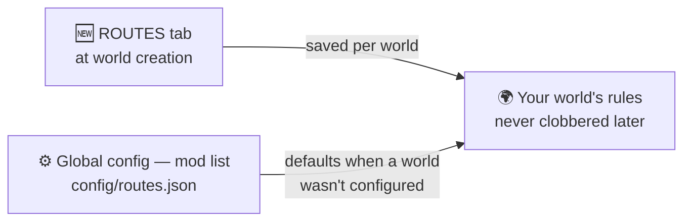

# 🧩 World Creation & Config

Everything is decided **when you create the world** — a dedicated **ROUTES** tab sits next to
**GAME / WORLD / MORE** on the create-world screen. Outside world creation there's a global config
screen for defaults, opened from the mod list (Mod Menu on Fabric, the **Config** button on NeoForge).

!!! tip "Looking for the NUZLOCKE tab?"
    The Nuzlocke ruleset, its starter options and the Soul Link toggles belong to
    **[Cobblemon Nuzlocke & Soul Link](../nuzlocke/commands.md)** — install that add-on and its
    tab appears next to this one.

## ROUTES tab

The tab is split into six sections, in the order you meet them: what the network is, what it
connects, how a road is shaped, what it is made of, where you start, and what you are shown.

### Route Generation

| Option | Default | Notes |
| --- | --- | --- |
| Generate routes | on | master switch |
| Native route generation | on | roads are drawn as chunks generate — no walking needed. Off falls back to the classic generator that builds as you explore |
| Connect all structures | off | also connect surface structures that are not towns — never one whose id names a ruin, an ancient thing or a mineshaft |
| Routes per city | 4 | a **ceiling**, not a count: each town rolls its own up to this, inside the band its size puts it in — a village low, a city high — so the network has hamlets and crossroads |
| Longest road | 1600 | the farthest two towns can be and still get a direct road |
| Ring roads | on | keep closing loops between nearby towns — loops are what enclose named **areas** |

### Towns & Settlements

| Option | Default | Notes |
| --- | --- | --- |
| Towns & landmarks | automatic | every structure your world has, each set to Settlement, Landmark or Ignored — see [Which structures get roads](which-structures.md) |
| Settlement allowlist (advanced) | empty | exact structure ids that count as towns. Empty = the automatic rule |
| Never spawn here | RS ocean village | towns that may never be the world's **first** town. They stay ordinary towns otherwise |
| Confirm towns exist | on | check the jigsaw really assembles before the network treats a candidate as a town — no towns on the map with an empty field under them |
| Bigger towns, more roads | on | settlements come as village, town or city by their real footprint, and a bigger one carries more roads. Needs **Confirm towns exist** |
| Town size | 64 | blocks across from which a settlement is a town rather than a village |
| City size | 128 | blocks across from which it is a city. `/routes debug settlements` shows how your world's towns fall into the three |
| Roads go around landmarks | on | a road steers around a landmark's real footprint instead of cutting through it, and around a surface structure you set to ignored in the Towns & landmarks list (2.0.72); where one fills the only way through, the road is still built |
| Landmark pull | 3 | 0–10: how strongly a road bends to pass beside the one landmark it visits — a few blocks, never a detour. 0 = off |
| Landmark reach | 96 | how far off a road's straight line, in blocks, a landmark can be and still pull it |
| Landmark signs | on | a signpost beside the road names the landmark it passes |

### Road Shape

| Option | Default | Notes |
| --- | --- | --- |
| Road width | 5 | odd numbers; the brush is symmetric around the centreline |
| Water crossing width | 10 | its own number, not a multiple of the road — open water reads much wider than it is |
| Road curviness | 5 | 0 = ruler-straight, 10 = maximum seeded wander |
| Straight bridges | on | a bridge over water runs straight from bank to bank however much the roads wander; off, the crossing weaves with the road. A bridge over a dry gap weaves either way |
| Steepest climb | 8 | tenths of a block per block, before a road cuts or bores instead of hugging the ground |
| Dig tunnels | on | off, a planned tunnel is built as a steep surface road over the top |
| Tunnel width | 9 | a tunnel's own width, twice the road's — only the bore, the ramp down to it stays road-width. Odd numbers, like the road |
| Tunnel height | 8 | floor to ceiling. Taller tunnels leave a thinner roof in low hills |
| Build bridges | on | off, a river becomes an open water lane and a dry gap is followed on the ground |
| Shape terrain around roads | on | the ground is road-shaped **before** anything is planted on it, instead of demolished afterwards. Decided once, when the world is created |
| Warm road chunks ahead | on | generate a road's chunks a little before you reach them, so the cost lands while you walk |

### Surface & Lighting

| Option | Default | Notes |
| --- | --- | --- |
| Road surface | Random (by biome) | Random paves each stretch from the palette of the biome it crosses; a material paves every road with that one block; several materials make a mix. See [Road materials](#road-materials) |
| Road wear | 0% | the share of a road's flat blocks laid as a worn version of their material; stairs never wear. See [Road wear](#road-wear) |
| Bridge deck | Random (by biome) | each bridge is decked in the timber of its biome, or in one material of your mix. See [Bridge deck and handrail](#bridge-deck-and-handrail) |
| Handrail | Random (per route) | each route rolls one of twelve fences and walls, or one material of your mix |
| Road lamp posts | Random | Random / On / Off — Random decides per route |
| Tunnel lighting | Random | Random keeps some tunnels as dark caves |
| Underwater lighting | Random | a sea lantern in the pillar under each water-crossing marker — Random decides per route |

#### Road materials

**Road surface** offers these choices on the ROUTES tab, and the same values in `config/routes.json` and
`/routes config set path_block_material`:

| Choice | Value | What the road is paved with |
| --- | --- | --- |
| Random (by biome) | `random` | the palette of the biome below (the default) |
| Dirt Path | `minecraft:dirt_path` | dirt path everywhere |
| Cobblestone | `minecraft:cobblestone` | cobblestone everywhere |
| Mossy Cobblestone | `minecraft:mossy_cobblestone` | mossy cobblestone everywhere |
| Gravel | `minecraft:gravel` | gravel everywhere |
| Stone Bricks | `minecraft:stone_bricks` | stone bricks everywhere |
| Polished Andesite | `minecraft:polished_andesite` | polished andesite everywhere |
| Packed Mud | `minecraft:packed_mud` | packed mud everywhere |
| Coarse Dirt | `minecraft:coarse_dirt` | coarse dirt everywhere |
| Mossy Stone Bricks | `minecraft:mossy_stone_bricks` | mossy stone bricks everywhere |
| Cracked Stone Bricks | `minecraft:cracked_stone_bricks` | cracked stone bricks everywhere |
| Andesite | `minecraft:andesite` | andesite everywhere |
| Sandstone | `minecraft:sandstone` | sandstone everywhere |
| Cut Sandstone | `minecraft:cut_sandstone` | cut sandstone everywhere |
| Cut Red Sandstone | `minecraft:cut_red_sandstone` | cut red sandstone everywhere |
| Mud Bricks | `minecraft:mud_bricks` | mud bricks everywhere |

Any other block id typed into `config/routes.json` works too, and shows on the tab under its id. An id the game
does not know is dropped; if nothing else is left, the road falls back to Random.

**Mixing materials.** Press **+ Add material** under *Road surface* to add a row. Each row is a dropdown of
the choices above and a *Share* slider; the shares are compared with each other, so 70 and 30 pave about 70% and
30% of the road. The materials are laid in organic patches a few blocks across, not block by block. *Random (by
biome)* can be one row of a mix and stands for the biome's own palette. **- Remove last** drops the last row;
with one row left the slider hides, because one material is the whole road. Up to six materials fit in a mix.

Example: Cobblestone at 60, Gravel at 25 and Random (by biome) at 15 paves most of every road in cobblestone
with gravel patches, and lets about one patch in seven follow the land. In `config/routes.json`, or with
`/routes config set path_block_material`, the same mix is written
`minecraft:cobblestone=60,minecraft:gravel=25,random=15`.

**What Random lays.** Each stretch takes its block from the biome it crosses, in patches a few blocks
across, so a road changes material where the land changes:

| Biome | Blocks, most common first |
| --- | --- |
| Badlands | cobblestone, cut red sandstone, gravel, stone bricks |
| Swamp, mangrove swamp | packed mud, mud bricks, mossy cobblestone, coarse dirt |
| Jungle | mossy cobblestone, mossy stone bricks, dirt path, gravel |
| Desert, beach, very hot biomes | cobblestone, cut sandstone, gravel, stone bricks |
| Frozen | stone bricks, cobblestone, cracked stone bricks, gravel |
| Cold | cobblestone, stone bricks, andesite, gravel |
| Temperate | dirt path, cobblestone, mossy cobblestone, stone bricks, gravel |
| Warm | dirt path, packed mud, sandstone, gravel |

Climbs are walked in slabs of the same family: a rise of one block, or two in a row, steps up in half blocks
(slab, full block, slab), so you climb without jumping. A climb of three or more rises in a row keeps stairs of the
same family (stone brick stairs on stone bricks, mud brick stairs on packed mud, andesite stairs on andesite).
A material without a slab or stair of its own (dirt path, gravel, coarse dirt) steps in cobblestone.

#### Road wear

**Road wear** (`path_wear_percent`, 0 to 30) turns that percent of a road's flat blocks into a worn version
of their material, scattered one block at a time. Stairs never wear, and a material not listed here does not
wear either.

| Material | Worn variants |
| --- | --- |
| Stone bricks | cracked stone bricks, mossy stone bricks, gravel |
| Mossy stone bricks | cracked stone bricks, mossy cobblestone |
| Cracked stone bricks | gravel, cobblestone |
| Cobblestone | gravel, mossy cobblestone |
| Mossy cobblestone | cobblestone, gravel |
| Dirt path | grass block, coarse dirt |
| Coarse dirt | gravel, dirt |
| Gravel | coarse dirt, cobblestone |
| Packed mud | mud, coarse dirt |
| Mud bricks | packed mud, mud |
| Andesite | gravel, cobblestone |
| Polished andesite | andesite, gravel |
| Sandstone | sand, smooth sandstone |
| Cut sandstone | sandstone, sand |
| Cut red sandstone | red sandstone, red sand |

#### Bridge deck and handrail

**Bridge deck** (`bridge_deck_material`) and **Handrail** (`handrail_material`) are built like the road surface:
a dropdown per row, a *Share* slider, **+ Add material** and **- Remove last**. The difference is that they are
never mixed within one piece: a bridge takes one deck material for its whole span, and a route takes one handrail
for its whole length. So the shares are shares of bridges and of routes: Spruce Planks at 70 and Oak Planks at 30
deck about 7 bridges in 10 in spruce. *Random* keeps the default rule (the biome's timber, the route's own fence)
and can be one row of a mix.

| Component | Choices |
| --- | --- |
| Bridge deck | Random (by biome), oak, spruce, birch, jungle, acacia, dark oak, mangrove, cherry, bamboo, crimson and warped planks |
| Handrail | Random (per route), oak, spruce, birch, jungle, acacia, dark oak, mangrove and cherry fences; cobblestone, mossy cobblestone, stone brick, mossy stone brick, andesite and diorite walls |

In `config/routes.json` the deck takes any planks id and the handrail any fence or wall id; other blocks are
dropped from the mix. Neither wears (see [Road wear](#road-wear)).

### World Spawn

| Option | Default | Notes |
| --- | --- | --- |
| Spawn in city | on | move a new world's spawn into the nearest town; off leaves the vanilla wilderness spawn |
| Pregenerate around spawn | 512 | chunks built in the background the first time you enter, so the roads and towns around spawn are already built when you walk out — the default reaches the spawn town and its first road, about 200 blocks. 0 = off |

### Map & Notifications

| Option | Default | Notes |
| --- | --- | --- |
| Zone notifications | Toast | how entering a route or an area is announced: Off / Toast / Announcement / Chat |
| Xaero chunk paint | on | tint chunks on [Xaero's maps](map-integration.md) by category. Needs Xaero's Minimap; inert otherwise |

Who stands on the roads and what gets built beside the towns is the Nuzlocke add-on's: **road
trainers**, the **gyms next to towns** and the **league** are configured on its
[NUZLOCKE tab](../nuzlocke/commands.md). Routes on its own builds the towns and the roads
between them.

The map **tint intensity** and **colours** (City / Route / Area) are not world-creation choices —
set them in play with [`/routesmap`](map-integration.md#changing-how-it-looks-routesmap), with the map
in front of you.

!!! info "Saved per world"
    Choices made in these tabs are stored **per world** and only applied to a brand-new world —
    loading an existing world never gets its rules clobbered. Picking **Hardcore** at world
    creation auto-enables the full [Nuzlocke rule set](../nuzlocke/commands.md).

## Global defaults

The global defaults live in `config/routes.json` (English & Spanish labels) and are used
when a world wasn't configured through the tabs. The map-paint intensity and colours are changed in
play with [`/routesmap`](map-integration.md#changing-how-it-looks-routesmap).

## Commands

The root is `/routes`; `/cobblemonroutes …` is accepted as an alias. The full manual — every
command, argument, permission and behaviour — lives on [the Commands page](commands.md).
