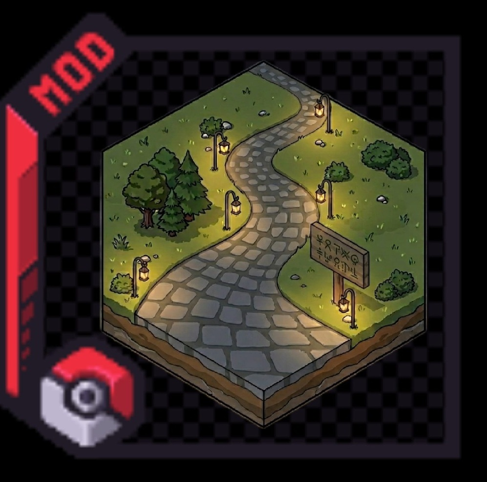

{ .hero-logo }

# Routes

Give your world a road network: **physical roads generated during worldgen** that connect its towns
and structures, named routes and areas, and map integration that ties it together. Roads are graded,
bridged and tunnelled to the terrain they cross, and every settlement they reach is one the game
really built.

<!-- mod-badges -->

[Get started](getting-started.md){ .md-button }
[Commands](commands.md){ .md-button }

## Highlights

- 🗺️ **[Dynamic routes](routes.md)** between towns and structures, fully part of worldgen — roads are
  graded to the land, bridge the water, bore through what they cannot climb, share a trunk where they
  run together, and get names like *Route 3: Steep Forest Pass*.
- 🧭 **[Map integration](map-integration.md)** (optional): waypoints and chunk paint on Xaero's maps
  and JourneyMap, and waystones named after their towns.
- 🛣️ **[Roads by hand](commands.md#road-a-road-through-land-already-explored)**: join two towns with
  the Road Planner and build the road even through land you have already explored.
- 🧩 **[World-creation tab](configuration.md)**: a dedicated **ROUTES** tab on the create-world
  screen — every rule set up-front, saved per world, down to the mix of road materials, the bridge
  decks and the handrails.
- 🎮 Playing a Pokémon world? **[Cobblemon Nuzlocke & Soul Link](../nuzlocke/index.md)** is a separate
  add-on that builds on this one: it locks encounters to the routes, areas and towns generated here,
  and sets the rules the road trainers follow.

## Get it

<!-- mod-spec -->

New here? Start with **[Getting Started](getting-started.md)**.
