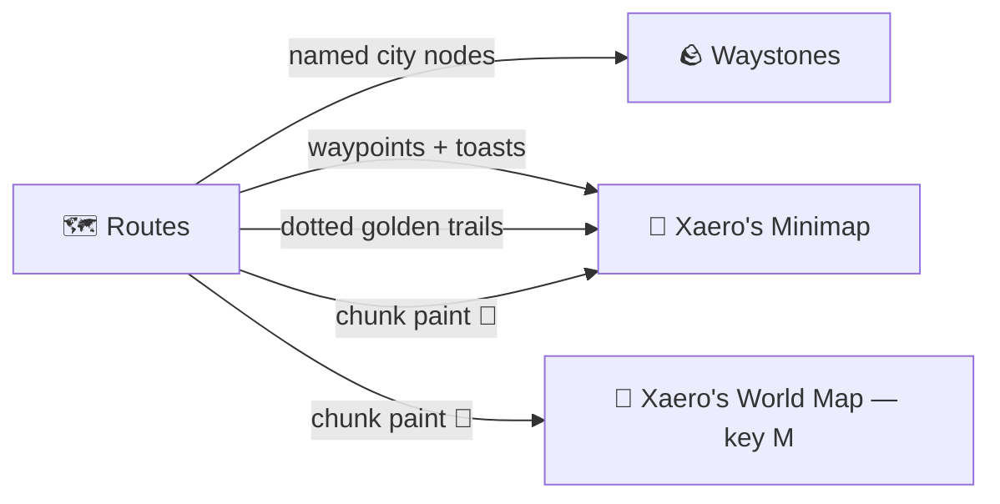

# 🧭 Map Integration

Routes talks to the maps you already use. Everything on this page is **optional** — the
mod detects what's installed and stays inert otherwise.

## Waystones

Activating a waystone registers it as a **named city** on the route network — your fast-travel
points become real places that roads connect to.

**Wraith Waystones** (Fabric only — that mod has no NeoForge version) is supported too. A waystone
takes the name of the Routes town it stands in the moment you discover it, and shares that town's
map marker, so the waystone, the town and the pin are one place under one name.

## Xaero's Minimap

- **Auto waypoints** — the first time you reach a **named town**, a **route** or an enclosed
  **area**, it drops a pin with a toast; every named waystone you activate does the same. Unnamed
  places are ignored, and a marker never doubles up — Xaero forgets runtime waypoints when you
  relog, so they are re-sent on join and de-duplicated on arrival. Whether they land in one set or
  three is the **waypoint grouping** choice, set with [`/routesmap`](#changing-how-it-looks-routesmap).
- **Chunk paint** 🎨 — the `xaero_chunk_paint` option (default on) tints chunks on the map by
  **category**, with a subtle low-opacity wash: **magenta** over cities/villages, **orange** over
  routes, and **teal** over an area once it is **fully enclosed** by your cities and routes — open
  wilderness stays unpainted until the network grows around it. Enclosed areas earn a name
  (**A1, A2, …** with a nature flavour, e.g. "A3-Frostpine") shown by their entry pop-up.

## Xaero's World Map

The chunk paint also renders on the **full-screen World Map (key M)** — visible independently of
the minimap's Cave Mode and of your Y level, on the surface and in caves alike.

## Changing how it looks — `/routesmap`

How the paint looks is a choice about **your own** map, so it is a command every player can use: no
operator rights, and it works on any server — even one without Routes — because it never leaves your
game. It turns the paint on and off, sets how strong each of the three tints is (**0 hides that
category**), picks each one's colour — which the matching waypoints follow — and chooses whether the
waypoints land in one set or one per category.

Type `/routesmap` on its own and a small screen opens over the world with all of it: drag a slider
and the minimap behind it re-tints as you go. Each setting is also a subcommand, for anyone who would
rather type it. Your choices are still there after rejoining.

To hide and show the paint with one key, bind **Show / hide chunk paint** under **Routes** in
Options → Controls → Key Binds. It ships unbound, so it never fights Xaero's own keys. Every argument is on
[the Commands page](commands.md#routesmap-how-your-map-looks).

!!! note
    Get the map mods from [the Xaero's Minimap page](https://modrinth.com/mod/xaeros-minimap) and
    [the Waystones page](https://modrinth.com/mod/waystones) — then everything above just works.
