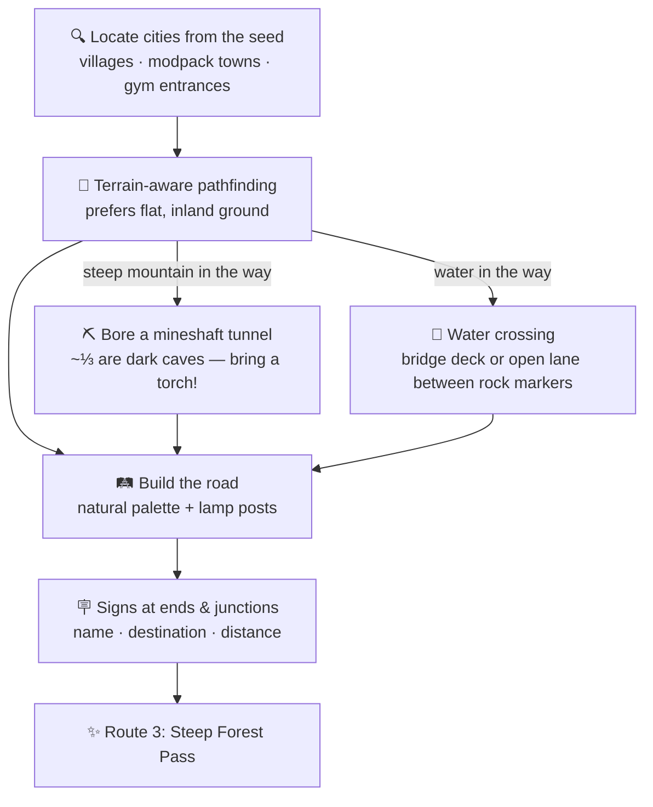

# 🗺️ Dynamic Routes

Routes grows a **road network through your world during worldgen** — no commands, no
walking the area first. Cities are found from the world seed, connected with terrain-aware paths,
and every road is signposted and named.

## What you get

- **Automatic road network** between cities — vanilla villages, modpack villages, the gym entrances
  of the packs [Routes ships a list for](which-structures.md#the-list-routes-ships), and any structure
  you list. Built incrementally and resumed after a restart.
- **Flat & inland paths** — the pathfinder strongly penalises slopes and keeps a buffer away from
  shorelines, while still crossing water when there's no alternative.
- **Mineshaft tunnels** — when a climb is too steep (or there's no surface path at all), the route
  bores a clean, walkable, oak-framed tunnel — twice the road's width and eight blocks tall —
  instead of an impassable cliff. About a third of tunnels are atmospheric **dark caves** — bring
  torches!
- **Descriptive route names** — every road gets a code plus an auto-generated name from the terrain
  it crosses (*Route 5: Coastal Road*, *Route 8: Marsh Crossing*), always the same for your seed.
- **Clean tree clearing** — a road crossing a tree removes the whole trunk and canopy; no floating
  leaves, no item spam. Trees and huge mushrooms don't grow within a few blocks of the road's edge,
  so no crown hangs over the road where you walk.
- **Water crossings** — always on the surface. A river gets a plank bridge with its pillars dropped to
  the riverbed, in one wood from end to end; a longer stretch stays an open lane of water to swim or
  sail, marked on both edges by natural rock markers, most of them lit, and the road meets it at the
  shore's own height. The seabed is never touched, and a frozen lake keeps its ice. Water the planner
  could not see coming (a river carved later by Streams Reflowing, an aquifer pool) is crossed on a
  timber bridge at the banks' height, not left as a swim gap. With Streams Reflowing installed, roads
  keep off its river banks and cross its rivers squarely.
- **Bridges on real supports** — the posts under a bridge's edges are full logs of the bridge's own
  wood, with a log beam across under the deck at every post row.
- **Climbs you can walk** — a road that climbs steps up in half blocks (slab, full block, slab), in the
  road's own material: it starts a climb a few blocks early and finishes it a few blocks late, so up to
  four rises in a row are walked in slabs. Only a longer climb keeps a stair, where the slabs run out.
  Every one-block step gets a stair or a slab, on the ramps up to a bridge, into a tunnel and out of a
  town too; a bridge deck that rises one block takes a slab. A wall that is still two blocks or more
  gets a ladder, whichever way you walk in.
- **Roads made of what you choose** — the surface can be one material or a mix laid in rounded
  patches, with an optional share of worn blocks (cracked or mossy bricks, gravel in cobblestone, grass
  through a dirt path). Bridge decks and handrails are chosen the same way, one material per bridge and
  per route. Left on *Random*, each stretch takes the palette of the biome it crosses. See
  [Configuration](configuration.md#surface-lighting).
- **Signs everywhere** — directional signs at each end and at junctions (one per road, even at a fork
  right by a chunk border), with plaza-paved crossings that stand out from the road, and a **welcome
  board** with the town's name where a road arrives.
- **Junctions built for the spot** — where two roads cross, the crossing is either a ringed
  **roundabout** around a lit pillar or an open **signed crossing** with fingerposts naming all four
  destinations. Roads that meet at different heights are an **overpass**: the upper one simply bridges
  over. A fork that lands inside a hill opens into a **chamber** where its tunnels meet, with its
  signposts on the chamber floor beside the roads.
- **Rest stops** — every few hundred blocks, a small camp just off the road: a campfire with log
  seats, a lantern post and a sign. Now and then one keeps a **supply chest** from the last traveller —
  rarely, so finding one still means something. With [Cobblemon Picnic](../picnic/index.md) installed,
  now and then a stop is one of its picnic tables instead — about 3 in 100, set by **Picnic stops**
  in [Configuration](configuration.md).
- **Landmarks along the way** — a road passing a pyramid, a tower or a ruin bends a little to go by
  it, keeps off its footprint, and puts up a signpost with its name. No road is planned *to* a
  landmark — see [Which structures get roads](which-structures.md).
- **Villages, towns and cities** — a settlement's real size decides how many roads leave it, so the
  network has quiet hamlets and busy hubs. A fork out of a big town stands past its last houses, never
  among them. A structure tagged `routes:settlement/village`, `routes:settlement/town` or
  `routes:settlement/city` gets that word after its name,
  so Pallet becomes *Pallet Town*. The cities of **Cobblemon Cities & Structures** (Pewter, Cerulean,
  Vermilion, Celadon, Fuchsia, Saffron, Cinnabar and Viridian, plus Lavender and Pallet when placed by
  hand) are towns of the network too.
- **Underground towns** — any structure can be set as an *Underground town* in
  [Which structures get roads](which-structures.md). Its road ends at the surface, and right beside the
  end a stone-brick **spiral stairway** goes down to the town: slab half-steps, a landing every 8 blocks
  down, a short tunnel at the bottom, and a *↓ town* board at the top naming the town below. Two
  underground towns are never joined directly; each is reached from a town on the surface. Nothing is
  set this way by default.
- **Route Pokémon** — with Cobblemon 1.8 installed, roads carry habitat blocks hidden in the paving,
  each spawning its own Pokémon family at its own level band, leaning toward the biome's natives (Water
  types by water crossings, Flying types on bridges). No legendaries, Ultra Beasts, Paradox Pokémon or
  starters. Turn them off with **Route Pokémon** in [Configuration](configuration.md#how-roads-look).
- **Route trainers** — with [Radical Cobblemon Trainers](https://modrinth.com/mod/radical-cobblemon-trainers)
  installed, a trainer stands beside the road every 160 blocks as you explore it, with a team near your
  party's level, and swimmers at water spots. No gym leaders, Elite Four or Champions. Without RCT
  nothing changes.
- **Roads meet the town's own streets** — a road joins a town at the open end of a street, at street
  level, never behind a house or climbing into the air. A pack can mark its street ends with an open
  jigsaw named `routes:city_exit`, and the road then continues the street that faces
  it most squarely.
- **Spawn in a city** — new worlds start next to the nearest city, on real ground, never in the
  water — coastal towns included.
- **A loading screen that shows the real wait** — while a new world opens, two towns and the road
  between them are the progress bar. Each step (surveying the towns around your spawn, generating the
  spawn chunks, building your spawn town) gets its share of the road by how long it really takes. The
  road's tip only moves while work actually finishes, the line under it counts tasks done, and it says
  *no progress for N s* when nothing has finished for a while.

!!! tip "Tune it per world"
    How many roads, how they look, materials, lighting and more are all set from the **ROUTES**
    tab at world creation, with one-click **Road network** and **Road style** presets on top — see
    [World Creation & Config](configuration.md).
