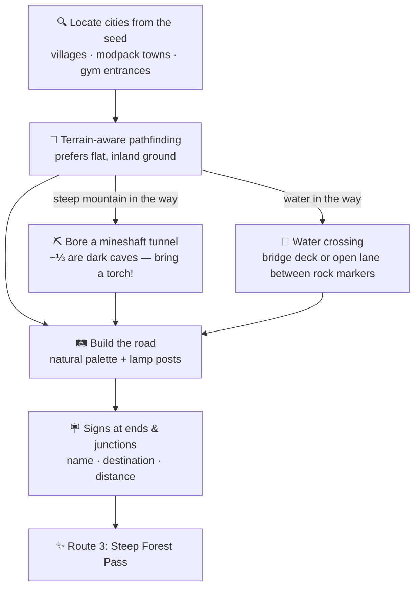

# 🗺️ Dynamic Routes

Routes grows a **road network through your world during worldgen** — no commands, no
walking the area first. Cities are found from the world seed, connected with terrain-aware paths,
and every road is signposted and named.

## What you get

- **Automatic road network** between cities — vanilla villages, modpack villages, the gym entrances
  of the packs [Routes ships a list for](which-structures.md#the-list-routes-ships), and any structure
  you list. Built incrementally and resumed after a restart.
- **Flat & inland paths** — the pathfinder strongly penalises slopes and keeps a buffer away from
  shorelines, while still crossing water when there's no alternative.
- **Mineshaft tunnels** — when a climb is too steep (or there's no surface path at all), the route
  bores a clean, walkable, oak-framed tunnel — twice the road's width and eight blocks tall —
  instead of an impassable cliff. About a third of tunnels are atmospheric **dark caves** — bring
  torches!
- **Descriptive route names** — every road gets a code plus an auto-generated name from the terrain
  it crosses (*Route 5: Coastal Road*, *Route 8: Marsh Crossing*), always the same for your seed.
- **Clean tree clearing** — a road crossing a tree removes the whole trunk and canopy; no floating
  leaves, no item spam.
- **Water crossings** — always on the surface. A river gets a plank bridge with its pillars dropped to
  the riverbed; a longer stretch stays an open lane of water to swim or sail, marked on both edges by
  natural rock markers, most of them lit. The seabed is never touched, and a frozen lake keeps its ice.
- **Signs everywhere** — directional signs at each end and at junctions, with plaza-paved crossings
  that stand out from the road.
- **Junctions built for the spot** — where two roads cross, the crossing is either a ringed
  **roundabout** around a lit pillar or an open **signed crossing** with fingerposts naming all four
  destinations. Roads that meet at different heights are an **overpass**: the upper one simply bridges
  over. A fork that lands inside a hill opens into a **chamber** where its tunnels meet.
- **Rest stops** — every few hundred blocks, a small camp just off the road: a campfire with log
  seats, a lantern post and a sign. Now and then one keeps a **supply chest** from the last traveller —
  rarely, so finding one still means something. With [Cobblemon Picnic](../picnic/index.md) installed,
  about a third of the stops are one of its picnic tables instead.
- **Landmarks along the way** — a road passing a pyramid, a tower or a ruin bends a little to go by
  it, keeps off its footprint, and puts up a signpost with its name. No road is planned *to* a
  landmark — see [Which structures get roads](which-structures.md).
- **Villages, towns and cities** — a settlement's real size decides how many roads leave it, so the
  network has quiet hamlets and busy hubs.
- **Spawn in a city** — new worlds start next to the nearest city, never in the water.

!!! tip "Tune it per world"
    Roads per city, trainer density, water-crossing style and more are all set from the **ROUTES**
    tab at world creation — see [World Creation & Config](configuration.md).
