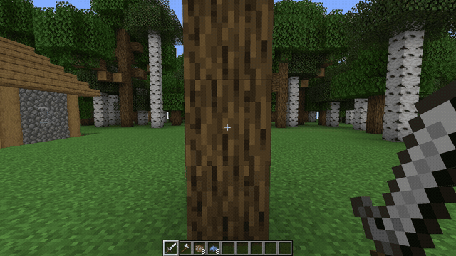
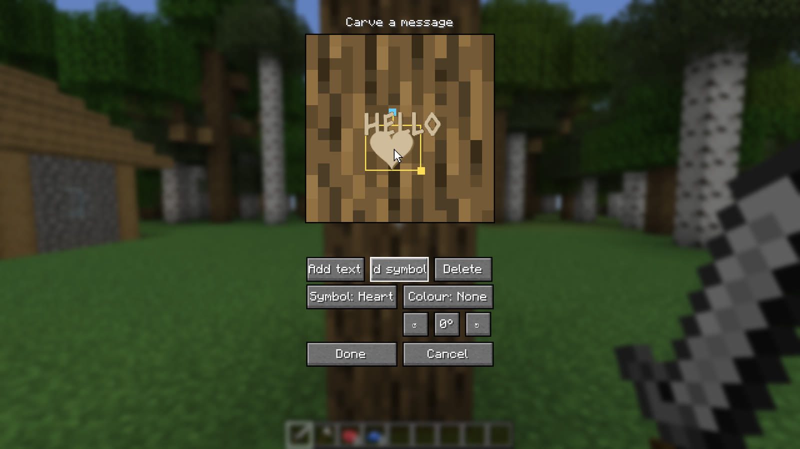
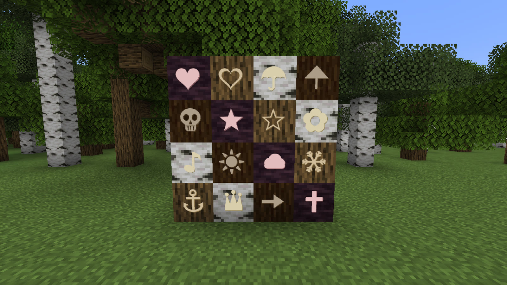
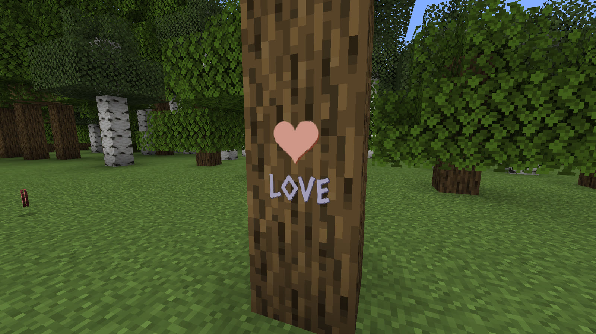
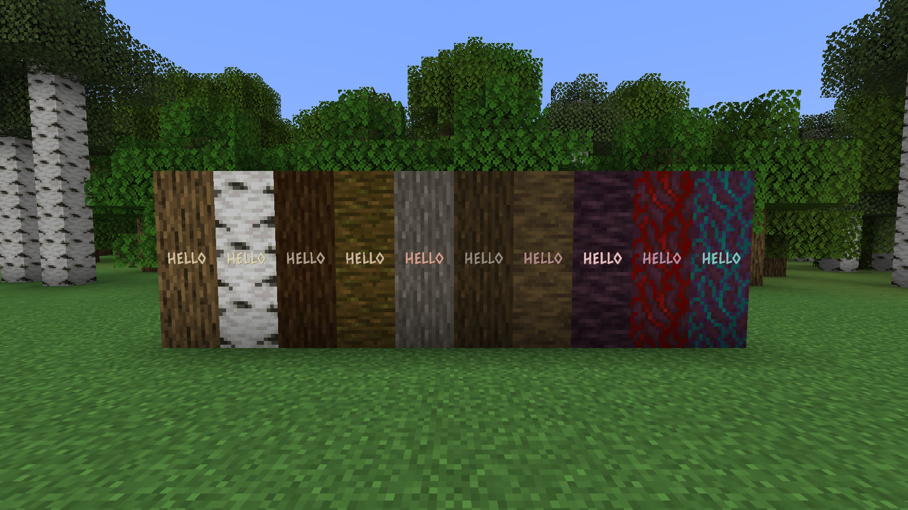
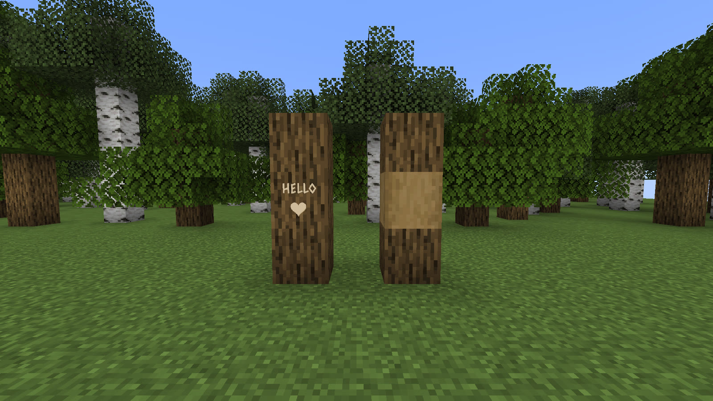

# Getting Started

Install the jar for your Minecraft version and loader, along with its
[dependencies](index.md#get-it). There is nothing to craft and nothing to unlock: the tool is the
sword you already carry.

## Carving

**Sneak + right-click a log with a sword.** Any sword, including one from another mod, and any log,
including one from another mod. The carving screen opens on the face you clicked.

A plain left-click with the sword chops the log exactly as it always did; only the sneaking
right-click carves.

Out of the box, a log that is already stripped cannot be carved: an axe could not take the message
off it again. A server can change which blocks take a carving.

Opening the screen is free. Writing a message costs **1 durability** from the sword and plays a
carving sound; close the screen without changing anything and nothing is spent. A server may change
the cost.

## The carving screen

The face is a **canvas**. You build a carving out of pieces, text and symbols, and arrange them on
it however you like.

| To | Do |
|---|---|
| Add a piece | **Add text** or **Add symbol** |
| Move a piece | Drag it |
| Resize it | Drag its corner handle |
| Rotate it | Drag the arm above it; hold **Shift** to snap to 15° steps. Or use **↺**, **0°** and **↻** |
| Remove it | Select it and press **Delete**, or the **Delete** button |
| Finish | **Enter** (when you are not typing in a text box), or the screen's confirm button |

One face holds up to **16 pieces** and **240 characters** of text across all of them. A server may
change both limits.

### Text

Each text piece has its own style and font:

- **B**, **I**, **U** and **S** turn on bold, italic, underline and strikethrough, in any
  combination.
- The **Font** picker offers *Carved*, the default, and four more: *Plain*, *Unifont*, *Galactic*
  and *Illager runes*. A datapack can add more; see [Custom Symbols & Fonts](symbols-and-fonts.md).

Type `@` at the start of a word to pick a name from everyone who has ever joined the server.

### Symbols

A symbol is a piece of its own, placed, sized and turned like text. Seventeen ship with the mod:

Heart · Hollow heart · Umbrella · Aiaigasa · Skull · Star · Hollow star · Flower · Music note · Sun
· Cloud · Snowflake · Anchor · Crown · Arrow · Cross · Pokeball

The Pokeball appears only when Cobblemon is installed. Text laid over a symbol is cut **into** it.

### Colour

The **Colour** picker offers the dyes **you are carrying**, any of the sixteen. The dye tints the
wood rather than painting over it, so a red carving in oak still reads as oak. The dye is spent
when you confirm. Re-saving a carving whose colours have not changed costs no dye.

## Editing and ownership

Sneak + right-click a face that already carries a message and the screen opens **with that carving
in it**, ready to change. Removing every piece and confirming deletes the carving.

Only the person who cut a carving, or an operator, can rewrite it. Anyone else sees *"Somebody else
carved this. An axe takes it off."* A server can let anyone edit; see
[Server Admin](server-admin.md).

## What it looks like

The bark is **not** repainted. A carved log looks like the log it is, and the lettering reads as
fresh-cut timber, in a shade taken from that species' own stripped wood, with a shadowed groove under
every cut. An oak carving and a warped stem carving look like their own trees rather than the same
paint on two backgrounds. Carvings are drawn from up to 48 blocks away.

## Removing a carving

**Strip the log with an axe.** It strips exactly as vanilla does and the message goes with the bark.
This works on anyone's carving, not only your own.

Stripping converts the **whole block**, not the face you were pointing at, so every message on that
log is gone, not only the one in front of you. An axe on a log with nothing carved on it behaves as
it always has.

## What a carving does not survive

- **Breaking the log.** Fell the tree and the message goes with it.
- **Building over the spot.** Whatever was there is cleared with the block.

There is no way to move a carving, and nothing keeps one alive past the block it was cut into.

## Known limitations

- **A world moved from Minecraft 1.21.1 to 26.x does not bring its carvings along.** 26.x keeps them
  in a file with a different name and does not read the old one. A world started on 26.x keeps its
  carvings like any other.
